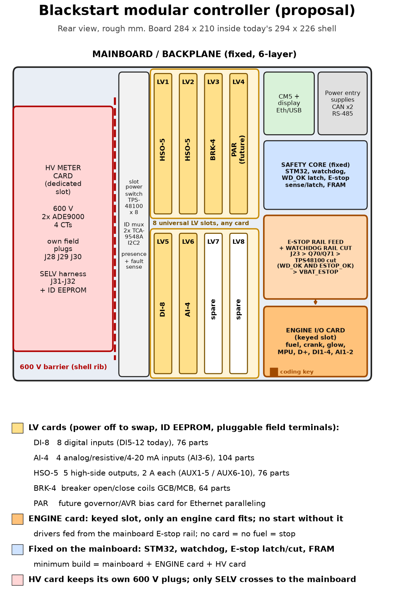

# Modular "card" architecture: Phase 1 proposal, Phase 2 cards, mainboard rework (§12)

Branch `m7-modular`, from the locked baseline tag `baseline-2026-11-23-locked` (5bac9fe). Written Mon Nov 23, 2026, ~10:15 AM HST.
**Phase 2 (§9, Nov 23 ~10:40 AM HST):** the engine I/O moves to its own keyed card slot; card schematics now live in `cards/`. The baseline schematics, BOM and PCB are still untouched. Nothing has been ordered or pushed.

Ethan's asks (Nov 23, 10:00 and 10:01 AM HST):
- Make the parts of the controller that fail into swappable "cards" (LV inputs, HV inputs, LV outputs, and so on).
- Make it **configurable**: swap in different cards to suit the generator.

Tags used: **[M]** measured from repo files or live LCSC this session. **[R]** rule-based, from my net-name classifier (`modular/tools/classify_cards.py`). **[DS]** datasheet or listing. **[E]** estimate. **[I]** inferred.

Supporting files in `docs/modular/`:

| File | What it is |
|---|---|
| `card_layout.png` | Phone-readable diagram of the slots and what goes on each card |
| `img/connector_options.png` | Pictures of connector options A, B and C, with prices and ratings |
| `img/*.jpg` | LCSC product photos. `img/A_din41612_female_datasheet_drawing_9001-12xxx.png` is the WingTAT drawing |
| `cards.csv` | Card list: contents, channels, part counts |
| `slot_pinout_LV.csv` | Proposed 96-pin LV slot pinout |
| `cost_delta.csv` | Every cost line, with its source |
| `tools/cost_delta.py` | Builds the cost table |
| `card_assignment_baseline.json` | Every baseline main-board ref, assigned to a card or kept on the mainboard [R] |
| `tools/classify_cards.py` | Builds that assignment. It reads the netlist that the blocks study exported (kicad-cli 9.0.2) to `/tmp/blk/genctl.net` from 5bac9fe |
| `tools/card_layout.py` | Draws both PNGs |

---

## 0. Recommendation in one screen

- **Mainboard/backplane, fixed.** It keeps only what must never be removable:
  - STM32 safety core, watchdog and engine-stop latch, E-stop sense/latch and the E-stop feed (J23), FRAM;
  - power entry and supplies, CAN ×2, RS-485, CM5 + display + Ethernet/USB, front-panel keys.
- **1 dedicated, keyed ENGINE slot (Phase 2, §9).** Fuel, crank and glow drivers, MPU speed, D+, COM_A/B, DI1-4 and AI1-2 with their protection are on a card. Only an engine card fits (coding key + ID EEPROM type check), and the engine will not start without it. Its drivers are fed only from the mainboard's E-stop rail, so a missing card means no fuel.
- **8 universal LV slots.** Any LV card goes in any LV slot. Each card is identified by an ID EEPROM, and firmware configures itself from what it finds. Card types:
  - **DI-8:** 8 digital inputs.
  - **AI-4:** 4 analog, resistive or 4-20 mA inputs.
  - **HSO-5:** 5 high-side outputs at 2 A.
  - **BRK-4:** breaker open/close coils.
  - **PAR:** a future paralleling bias card for the governor and AVR.
- **1 dedicated HV slot.** This is the existing `genctl_meter` board, almost unchanged, plus an ID/calibration EEPROM. It keeps its own 600 V field plugs, and only SELV crosses to the mainboard on the existing Micro-Fit harness.
- **LV connector:** DIN 41612 type C, 96 pins.
  - Card side: WingTAT 9001-11961C00A (LCSC C5173361), right-angle male.
  - Mainboard side: 9001-12961C00A (C5173363), vertical female.
  - About $2.57 per pair at qty 1 [M-LCSC], 2 A per contact, AC 1000 V for 1 min [DS].
  - Chosen because it is rugged under vibration, cheap, solderable by hand, and needs no gold fingers.
- **Mechanical:** cards stand vertically in two rear "card bays" and load from the rear, like a PLC I/O rack. The field plug comes off, one screw comes out, and the card slides out. The bays stick out about **14 mm** past today's rear skin [E]. **Overall depth grows about 8 mm**: about 76 mm to the plug tips, against 68.25 mm today [E].
- **Safety:** swap only with power off.
  - Removing a card can only de-energize things. Hardware cuts slot power the moment PRESENT goes away.
  - The E-stop, watchdog and fuel/crank paths never pass through a card.
  - A card that is missing, wrong or unrecognized stays unpowered. Any function mapped to it is unavailable, and if that function is protection-class, the engine will not start.
- **Cost of the baseline-equivalent build** (5 LV cards + HV) against the one-board design: **about +$276 at qty 1 and about +$108 per unit at qty 10.**
  - That is +15.6 % and +8.6 % on the $1,767 / $1,259 controller totals in `review/bom_split/totals.json`.
  - More than half the qty-1 delta is fixed fees for 4 extra small PCB/PCBA orders.
  - **Part count:** about 1,583 against 1,367, so +216 or +16 % [R+E].

---

## 1. Card partition

### 1.1 What moves and what stays [R]
`classify_cards.py` assigns every one of the 1,147 baseline main-board parts by net name:
- `DIn` nets with n ≥ 5 go to DI-8; `AIn` with n ≥ 3 go to AI-4.
- `AUX1-5` and `AUX6-10` go to the two HSO-5 cards; `GCB_*` and `MCB_*` go to BRK-4.
- Everything else stays on the mainboard, in the blocks-study buckets.

Boundary parts (shared bias, decoupling) are heuristic, the same caveat as `review/springy/blocks/blocks_report.md`.

| Card | Slot | Channels | Moved from baseline [R] | Added [E] | Parts | Baseline parts cost moved, qty 1 / 10 [M-BOM] | What fails in the field |
|---|---|---|---|---|---|---|---|
| **Mainboard** | fixed | DI1-4, AI1-2, MPU/D+/COM, fuel, crank, glow, E-stop trip | 839 stay | +152 (8 slot power switches, sockets, ID mux, expanders) | **~991** | n/a | Low exposure. It keeps only the engine-core front ends |
| **DI-8** | any LV | 8 DI (today DI5-12) | 57 | +17 (DIN, EEPROM, MCP23S17, own DI bias switch, headers) | **~74** | $13.27 / $11.33 | TVS and front-end damage from surges and miswiring |
| **AI-4** | any LV | 4 AI: resistive sender, 4-20 mA, 0-10 V (today AI3-6) | 80 | +9 (DIN, EEPROM, TCA9555, header) | **~89** | $4.93 / $4.29 | Sender shorts, 4-20 mA loop faults, surges |
| **HSO-5** ×2 | any LV | 5 high-side outputs (AUX1-5, AUX6-10) | 59 / 62 | +12 (DIN, EEPROM, MCP23S17, '541 OE buffer, TMUX1208) | **~71 / 74** | $23.66 / $24.84 at qty 1 | Shorted loads, inductive kick, miswiring. These are the most likely cards to fail |
| **BRK-4** | any LV | GCB/MCB open/close coils | 48 | +12 | **~60** | $18.99 at qty 1 | Coil shorts |
| **PAR** (future) | any LV | 2-4 isolated governor/AVR bias outputs [E] | 0 | 40-60 [E] | 40-60 | n/a | Undesigned (see §7) |
| **HV meter** | dedicated HV | GEN V 3+N, BUS V 3+N, GEN I ×4 | 220 (the whole `genctl_meter`) | +4 (AT24CS32 + C + 2 pull-ups) | **~224** | $63.89 / $53.42 (meter BOM TOTAL) | 600 V transients, MOVs, CT wiring |

**Full build** (example 2 below): 991 + 74 + 89 + 71 + 74 + 60 + 224 = **~1,583 parts**, against 1,147 + 220 = 1,367 (+216, +16 %) [R+E]. The "added" counts don't subtract mainboard parts that become redundant, such as the shared '541 buffers, TMUX1208s and some TCA9555s. So they are conservative.

### 1.2 Why the engine core stays fixed
- **E-stop, watchdog, fuel and crank stay on the mainboard.** The battle-short scope is "E-stop + overspeed" (`docs/FW_REQ_BATTLESHORT.md`), and the narrow protection path is about 217 parts (blocks report §7). Keeping them fixed means no card swap, bad card or loose connector can touch the engine-stop path.
- **The 10 A fuel/crank copper stays where it is.** It runs on `VBAT_ESTOP` with its 10 A copper target (`docs/RAIL_PLAN.md`), and it shouldn't cross a connector.
- **DI1-4 and AI1-2 stay too,** so the minimum build can protect an engine with no LV cards:
  - DI1-4 covers low oil pressure, high coolant temp, low coolant level and an overspeed switch.
  - AI1-2 covers the oil pressure and coolant temperature senders.
  - Their front ends do take surges, so this is a trade. A failed DI1-4/AI1-2 channel means a mainboard repair. Any of those functions can be moved to a card channel in config if the user prefers (§3.3).
- **CAN and RS-485 stay too.** They are already isolated (CA-IS3062W), only 28 parts, and tied to STM32 FDCAN/USART pins that a universal slot does not carry.

### 1.3 Example builds (configurability)
| Build | Cards | LV slots used | Notes |
|---|---|---|---|
| **1. Small standby set** (single set on an ATS, no paralleling) | Mainboard + HV + 1× HSO-5 | 1 of 8 | DI1-4/AI1-2 cover engine protection. The HSO-5 drives alarm, fuel pump and block heater. The ATS does the transfer, so no BRK-4. |
| **2. Prime-power set with full metering** (the baseline's I/O) | Mainboard + HV + DI-8 + AI-4 + 2× HSO-5 + BRK-4 | 5 of 8 | Same I/O as today's single board: 12 DI, 6 AI, 10 AUX, 4 breaker coils. |
| **3. Paralleled set** (Ethernet paralleling, decided Nov 23) | Build 2 + PAR | 6 of 8 | BRK-4 is required for the GCB. PAR does the governor/AVR bias. Ethernet uses the CM5 port, so it needs no card. 2 spare slots remain, for example an extra DI-8 or AI-4. |

### 1.4 Minimum build (must always be present)
- **Mainboard,** which carries the safety core, watchdog latch, E-stop, fuel/crank/glow, speed, VBAT sense, DI1-4 and AI1-2.
- **HV meter card.** A missing meter is already a no-start/shutdown-class fault (`docs/FW_REQ_METERING_PRESENCE.md`), so nothing changes there.
- **The CM5 is not needed for the engine to run protected.** The existing `CM5_LOST` handling covers that. It is needed for the screen and for configuration.

---

## 2. Backplane and connector

### 2.1 Connector options (pictures: `docs/modular/img/connector_options.png`)
| | **A. DIN 41612 type C, 96 pins (recommended for LV slots)** | B. PCIe x1 card-edge socket | C. Molex Micro-Fit 3.0 2×8 cable (kept for the HV card) |
|---|---|---|---|
| Part | Card: WingTAT 9001-11961C00A (C5173361), RA male. Mainboard: 9001-12961C00A (C5173363), vertical female | Samtec PCIE-036-02-F-D-TH (C194068) | Molex 43045-1600 header (C277731) + 43025-1600 housing (already on the BOM as J31/J32) |
| Price, qty 1 / qty 10+ | $1.2659 / $1.061 + $1.3035 / $1.0953 [M-LCSC 10:09 AM HST] | $2.8379 / $2.5008 [M-LCSC], plus gold fingers on every card [E] | $1.35 / $1.15 per header (SPLIT_SCOPE §4) |
| Stock (LCSC) | 3,161 / 982 [M] | 27 [M] | 1,705 (SPLIT_SCOPE) |
| Rating | 2 A per contact, AC 1000 V for 1 min, 20 mΩ, -55 to +125 °C (-67 to 257 °F) [DS, WingTAT drawing] | 2.2 A per pin (2 adjacent pins powered), 7.65 mm insertion [DS Samtec F-219] | On the BOM today |
| Size | Female 95 mm long × 10.6 mm × 11.6 mm tall. Male RA 94 mm × 13.2 mm × 11.1 mm [DS] | About 25 mm long, 11 mm tall [DS/photo] | 2×8, 3.0 mm pitch |
| Good | Rugged in vibration (a railway/industrial standard). Polarized shroud. Through-hole, so easy for DIY. No gold fingers. Many pins for power and ground | Very compact cards | Positive latch, cable takes up tolerance, works at any position |
| Bad | 95 mm long, so the cards are about 100 mm long | Wiping contacts on a vibrating genset. Hard gold on every card. Low LCSC stock. 1.0 mm pitch is harder for DIY | A loose harness for every card, more handling, a crimp tool |

**Choice:** A for the 8 LV slots and C, unchanged, for the HV card. B is the fallback if the card bays have to shrink.

**Not checked this run:**
- DIN 41612 versions with staggered first-make/last-break contacts. These would make hot-swap cheaper.
- DigiKey/Mouser stock for any of the three.

### 2.2 LV slot pinout (`modular/slot_pinout_LV.csv`)

> **Pass 1 update (§13):** +5V_SLOT is removed; a8/b8 are reserved (NC). `slot_pinout_LV.csv` is current.
96 pins, rows a/b/c × 32 positions.

| Positions | Signals |
|---|---|
| 1-3 | **VBAT_FIELD** ×9, switched per slot |
| 4-6 | **FIELD_GND** ×9 |
| 7 | GND guard row |
| 8-9 | +5V_SLOT ×2, +3V3_SLOT ×2, both switched |
| 10 | +3V3_ID (always on, EEPROM only), PRESENT_N (tied to GND on every card) |
| 11-12 | SPI SCK/MOSI/MISO/CS_N (shared bus; CS decoded per slot) |
| 13 | I2C SDA/SCL. A **dedicated slot I2C bus**, one TCA9548A channel per slot |
| 14 | INT_N, RST_N |
| 15 | **OUT_EN_N** (active low, Phase 2), CARD_FAULT_N |
| 16-17 | SLOT_ID0-2 + parity (backplane straps), ANA_OUT (to an STM32 ADC through a backplane TMUX1208) |
| 18-30 | Reserved. Every second b-row pin is GND |
| 31-32 | GND |

- **Why a separate I2C bus:**
  - The SOT-23-5 AT24CS32 has a fixed address that I believe is 0x50. That would collide with the FM24CL64B FRAM at 0x50 on I2C1 (`firmware/ARCHITECTURE.md` §9.3). Check the address in Phase 2.
  - An AI-4's ADS1115 (0x48) would collide with the mainboard ADS1115s.
  - So the card bus must go on its own STM32 I2C peripheral. Its pins are a Phase-2 check [I].
- **STM32 pins needed:** about 11 (SPI 3, CS decode 4, I2C 2, ADC 1, INT 1). The ~15 AUX/breaker EN and readback GPIOs that move onto cards are freed, so this should fit. That's an inference, to be checked against the U7 pin map in Phase 2.

### 2.3 Keying and identification
- **Wrong-slot keying isn't needed between LV slots,** because every LV slot is universal. The DIN shroud prevents a card going in backwards.
- **An LV card cannot reach the HV slot.** The HV card uses a different connector (Micro-Fit harness) in a separate bay behind the 600 V barrier rib, so the two can't be mixed up mechanically.
- **ID EEPROM on every card:** AT24CS32-STUM-T (C147891), 32 Kbit, SOT-23-5, $1.43 / $1.17, stock 243 [M-LCSC].
  - I believe the AT24CS family carries a factory 128-bit read-only serial number. I haven't re-read the datasheet this run, so treat that as [DS to verify].
  - Proposed record: `magic, format_ver, card_type(u16), hw_rev, variant (e.g. 12/24 V, channel count), declared VBAT_FIELD max current, declared +5V/+3V3 load, manufacture date, calibration block (per-channel gain/offset), CRC-16`. The serial number comes from the factory area.
  - **HV card:** the record also holds the ADE9000 calibration (gain/phase/offset per channel), so a replacement meter card brings its own calibration. The EEPROM sits on the SELV side, beside the ISOW7841 primaries. Its I2C crosses J31/J32, using the spare pin plus one of the 5 GND pins, or a 2×10 Micro-Fit [E]. That is the only HV-card change.
- **Slot detection:**
  - PRESENT_N is read through a backplane TCA9555.
  - SLOT_ID straps let the card report which slot it is in, so firmware can cross-check that slot n answered on mux channel n.
  - The HV card keeps `MTR_DET_N` as it is today.

### 2.4 Per-slot power budget

> **Current state (Pass 4, §15 + §16):** the slot shunt is 5 mΩ (SCP 10.6/13.5/16.6 A), the LV slots share a bank switch (SCP 21.2/28.6/36.3 A) plus a hardware overload cutoff (HOT 3.15–3.76 A, ROOM 5.11–6.08 A), and +5V_SLOT is gone. The table below is retained only as the Phase 1 proposal; use §15 and §16 for live values.
| Rail | Per-slot limit | Hardware | Notes |
|---|---|---|---|
| VBAT_FIELD | **6 A continuous [E]**; pulses up to the slot trip | TPS48100-Q1 + 2× BSC070N10NS5 + shunt, the same circuit as fuel/crank (`bom/design_spec.md`) | With a 10 mΩ shunt the trip scales to about 7.7/9.9/12.3 A (min/typ/max). I derived that from the 20 mΩ figure of 3.86/4.97/6.14 A; check it against the datasheet in Phase 2. 9 contacts × 2 A = 18 A rated, so 6 A leaves 3× margin |
| +5V_SLOT | 0.5 A | TPS2553 with RILIM 49.9k, about 0.52 A nominal (`RAIL_PLAN` §USB) | Enabled by firmware after the ID check |
| +3V3_SLOT | 0.25 A [E] | TPS2553, RILIM to pick | |
| +3V3_ID | < 5 mA | 68 Ω 1206 series (C17976, Pass 2 m14) | Always on, so the EEPROM can be read before the card is powered |

- **The system limits still apply on top:** F1 chain 10 A at room / 8 A hot, and AUX caps of 5.0 A room / 3.0 A hot (`firmware/ARCHITECTURE.md` §12).
- **At boot,** firmware adds up each card's declared draw from its EEPROM. If enabling a card would exceed the slot or system budget, that card stays off and raises a `CARD_BUDGET` alarm.
- **Output current ratings stay as today:**
  - HSO-5: 2.0 A per output (`aux_out_limit_A`), TPS1HTC30 ILIM 2.41/3.01/3.61 A at RILIM 33.2k.
  - BRK-4: drives interposing relay coils only: ≤ 2.4 A including pull-in, ≤ 100 ms, one at a time. Breaker coils are switched by the external relay contacts.

### 2.5 HV isolation and creepage
- **The HV card is the existing `genctl_meter`** (82 × 167 mm coplanar side-car). Its rules are unchanged:
  - 600 V creepage between hot nets of 5.5/6.3 mm;
  - 8.0 mm clearance and 6.6 mm creepage from live parts;
  - reinforced 8.0/12.6 mm where earthed metal is involved (enclosure v3 README, Phase 14).
- **The isolation barrier is on the card:** the ISOW7841 isolators with their integrated DC-DC.
- **Only SELV crosses to the mainboard:** 7 SPI/control lines, +3V3, GND, detect (SPLIT_SCOPE §1), plus the new EEPROM I2C pair.
- **J28/J29/J30 stay on the card** as pluggable Phoenix plugs, so a swap needs no rewiring.
- **⚠ CT secondaries must be shorted before J30 is unplugged.** An open CT secondary on a loaded generator can produce dangerous voltage. The install guide must require a shorting terminal block in the CT circuit (INSTALL_SAFETY update in Phase 2).

---

## 3. Safety

### 3.1 Swap rule
- **Power off to swap, both battery and AC.** For the HV card, isolate the voltage-sense feeds and short the CTs first.
- **Hot-swap is not supported.** It is made *survivable*, which costs little:
  - Each slot's TPS48100 and TPS2553 enables are ANDed in hardware with PRESENT. Pulling a live card cuts its slot power immediately, with no firmware step.
  - OUT_EN_N = NOT(WD_OK AND SLOT_EN_x AND PRESENT), also in hardware (Phase 2: active low with a 10k pull-up on every card, so an open or unplugged line means outputs off). Every card output buffer (SN74LVC541 OE) is off unless the watchdog is healthy, and every driver EN input has a pull-down on the card. That is today's fail-safe default (ARCHITECTURE §2, §13.2), carried onto the card.

### 3.2 What the STM32 does
At boot every slot is unpowered. Firmware then reads PRESENT_N, then each EEPROM on +3V3_ID, then compares what it finds with the **commissioned configuration** stored in FRAM (slot → card type + serial):

| Case | Action |
|---|---|
| Card matches type and serial | Power the slot, run the card self-test (output-off readback, DI bias test), enable |
| **Same type, new serial** (a replaced card) | Power and self-test, load calibration from the card, show "Card replaced: slot n" on the UI. **The next start needs an operator acknowledgment** at the panel (recommended; open question 3) |
| Missing, wrong type, unknown type, bad CRC, fails self-test, or over budget | **Slot stays unpowered.** Raise `CARD_FAULT` slot n. Every function mapped to it is unavailable. If any of those functions is **protection-class** (a shutdown input, or the GCB on a paralleled set): **no start** (IDLE → PREHEAT refused, like the DI_BIAS lockout rule). Otherwise: alarm only |
| New card in a slot that wasn't commissioned | Power it, raise a "new card" notice. Its channels stay unmapped until they're assigned in the config suite |
| Card lost while running (PRESENT edge, failed SPI/CRC, CARD_FAULT_N) | Its slot power drops in hardware. If the card carried a protection-class function: shut down on the existing fault path (FUEL_EN = 0, GCB open; the EN gates and the VBAT_ESTOP feed are on the mainboard, so this always works, even if the lost card is the engine card: no engine card = no fuel). Otherwise: alarm. A missing BRK-4 blocks every breaker close but never opens a closed breaker by itself. That mirrors the METERING_SILENT BUS rule, and the ESTOP_TRIP breaker shunt-trip (U68) stays on the mainboard. Re-enumeration only happens after a power cycle |
| HV card | Existing `FW_REQ_METERING_PRESENCE` rules, plus `METERING_UNCALIBRATED` (blank or bad calibration CRC) → block breaker close until it's calibrated (open question 3 also covers this) |

### 3.3 Auto-configuration
- **Card drivers are picked by card type ID.** The channel map is `logical function → (slot, channel)` or `(MB, channel)`. It lives in FRAM with CRC and A/B copies, like the battle-short config, and can only be edited while stopped.
- **The CM5 config suite** shows the cards it found and lets the user map functions to channels. The STM32 validates the map against SAFE_MAX, as it does today.
- **Moving a card to a different slot** is allowed after an acknowledgment. The serial number follows the card, and the map follows by serial when the type is unique.

### 3.4 Paths that never cross a card
- E-stop loop, sense and latch, the J23 E-stop feed, ESTOP_TRIP, and the watchdog/latch (TPS3431, 74LVC1G74) with the WD_OK AND gates.
- Phase 2 change: fuel, crank, glow, MPU/D+ speed, DI1-4 and AI1-2 now cross the **keyed engine slot** (§9). Only VBAT_ESTOP (switched upstream) and already-gated EN signals go to the card, so no card fault can turn fuel on.
- External relays stay de-energize-to-stop (ARCHITECTURE §11.1). Pulling any card can only de-energize its outputs.

---

## 4. Mechanical (rough, [E] unless noted)
- **Today [M]:** board 284 × 210 at Z 16.0 (F) / 17.6 (B). Rear shell 294 × 226 × 48 (Z 4-48). 30.4 mm free behind the board. Total depth behind the front face 68.25 mm. The field plugs already exit through rear windows.
- **Recommended: rear-loading vertical cards in two bays.**
  - **Bays:** two of 4 slots each at 20 mm pitch.
    - Top bay at about x 108-188 / y −11..83, where the output terminal row J24-J27 is today.
    - Bottom bay at about x 108-188 / y 96..190, where the input row J19/J20 is today.
  - **Card:** about 100 × 30 mm, 1.6 mm, 4-layer, parts up to about 10 mm on the front side and 3 mm on the back. That gives 3,000 mm² per side, against a 1,100-1,350 mm² courtyard need per card [M fparea], so 20-45 % used.
  - **Height stack:** the card edge sits about 13 mm above the board in the 11.6 mm female (from the DS drawings). The card top lands at about Z 61, and a right-angle KF2EDGR-style header on the top edge takes the plug, mated, to about Z 76.
  - **Shell change:** the shell skin over the two bays moves from Z 48 to about Z 62 (**+14 mm**). Each card's PA12 faceplate sits flush in the skin, with card guides printed into the shell and one captive screw per card. The fin plate and CM5 heat path elsewhere are unchanged.
  - **Overall depth:** about 76 mm to the plug tips, against 68.25 mm (**+8 mm**). The outline (294 × 226) and panel cutout are unchanged.
  - **Swap:** unplug the field plug(s), loosen 1 screw, pull the card. The enclosure is never opened.
- **Mainboard area:** the bays take about 16,000 mm² (DIN sockets plus the space under the cards). Low parts (≤ 12 mm) can still go in the 9.4 mm strips between sockets, which is where the slot power switches go.
  - Outside the bays: about 42,000 − 16,000 = 26,000 mm² usable, for about 16,750 mm² of remaining mainboard courtyard plus about 1,200 mm² of slot switches. That's about **69 % used**, against 56 % today [E].
  - Tighter, but still fine. The blocks study found the problem was organization and rules, not area.
  - **Shell posts 1 and 2** (x 95-105) border the bays, so they may need to move slightly.
- **HV card:** stays in its coplanar side-car bay with the barrier rib at x 73. Swapping it means opening the rear shell. That's acceptable, because it should be rare and needs a full 600 V isolation anyway.

**Mechanical alternatives:**

| | A. Coplanar tiles (like the HV side-car) | **B. Rear-loading vertical bays (recommended)** | C. Stacked mezzanine |
|---|---|---|---|
| Depth change | 0 | +8 mm overall (+14 mm in the bays) | 0 if ≤ 22.8 mm stack over low-profile areas only (blocks report §8) |
| Swap without opening the shell | No (shell off, and the clamps hold through the shell) | **Yes** | No |
| Space | Tiles eat mainboard outline | Bays reuse today's terminal-row zones | Only over low-profile areas, and it fights the CM5 heat path |
| Verdict | Fallback if no depth change is allowed | **Pick** | Not recommended |

---

## 5. Cost and part-count delta (`modular/cost_delta.csv`)

> **Superseded:** the current cost is in §13 (`true_cost_delta.csv`). This section is the Phase 1 estimate.
Build 2 (baseline-equivalent I/O: DI-8, AI-4, 2× HSO-5, BRK-4, HV) against the one-board baseline:

| Group | qty 1 | qty 10 (per unit) | Source |
|---|---|---|---|
| Backplane, 8 slots (DIN female, TPS48100 + 2 FETs + shunt, 2× TPS2553, AND gate, passives) | $56.95 | $47.72 | M-LCSC / M-BOM, passives E |
| Backplane shared (TCA9548A, 2× TCA9555, TMUX1208, decoder) | $3.15 | $2.48 | M, decoder E |
| Card overhead (5 DIN males, 6 EEPROMs, 4 MCP23S17, 3 '541, 3 TMUX1208, TCA9555, DI bias copy, passives) | $29.50 | $24.36 | M, some E |
| 4 extra PCB/PCBA orders (PCB $8, fixed fees $13.74, extended-part loading about $18.42 per order) | $160.64 | $17.66 | E / DS (JLC fee table via SPLIT_SCOPE §7) |
| Mechanical (card bays, faceplates, guides) + HV harness tweak | $26.00 | $15.80 | E |
| **Total** | **≈ +$276** | **≈ +$108** | |

- **Against the controller totals** of $1,767.45 / $1,259.04 (`review/bom_split/totals.json`): **+15.6 % / +8.6 %**.
- **Savings not subtracted:** shared mainboard parts made redundant by cards ('541s, TMUX1208s, some TCA9555s).
- **Build 1** (1 HSO-5) needs only 1 card design ordered, so its delta is roughly backplane $60 + card $7 + 1 order $40 + mechanical $26, **about +$133 at qty 1 [E]**. It also has fewer parts than today's board.
- **Spares, parts only, qty 1** [M-BOM moved + overhead]:

  | Card | Cost |
  |---|---|
  | DI-8 | about $19 |
  | AI-4 | about $8 |
  | HSO-5 | about $29 |
  | BRK-4 | about $25 |

  Add about $3-40 of board and fees, depending on batch size [E]. **Compare: a single dead output on the one-board design means a whole new main board** (about $210 of fab/assembly estimate + $343 of parts, from SPLIT_SCOPE).

### Partition options compared
| | P1. Few big cards (IN, OUT, HV) | **P2. Universal function cards (recommended)** | P3. Per-channel plug-in modules | P4. Remote DIN-rail I/O over CAN/RS-485 |
|---|---|---|---|---|
| Cards in a full build | 3 | 6 | ~45 | n/a |
| Configurable per generator | Low | **High** (any LV card, any slot) | Highest | High |
| Spare cost when one channel dies | ~$45-55 [E] | ~$8-29 | ~$1-5 | Varies |
| Cost delta, qty 1 / qty 10 | ~+$125 / +$50 [E] | +$276 / +$108 | ~+$300 / +$150 [E]: 45 connectors, no room for per-module EEPROMs | Off-board modules |
| Safety | Simple | Simple; ID per card | Hard: 45 contacts to trust, no ID | **Protection must not depend on a bus**, so it only suits non-protection expansion |
| Fits the enclosure | Needs taller cards | Yes (+8 mm) | Yes but crowded | n/a |

**P2 wins on configurability, repair cost and safety.** P4 stays as a future add-on through the existing J7 expansion bus.

---

## 6. Fit with the other plans
- **Ethernet paralleling (decided Nov 23):** the network talk uses the CM5 Ethernet port, so it needs no card. The undesigned governor/AVR bias becomes the **PAR card**.
  - It needs an isolated bias output to suit each governor and AVR, from a DAC over the slot SPI, so it needs no timer pins.
  - It can go in any spare LV slot. The sync check and reverse-power trip stay local on the STM32, from HV-card readings.
- **Block-based layout plan:**
  - Every card is a natural, self-contained block: laid out once, with its own rules, and reused across builds.
  - The mainboard drops from about 33-36 blocks to about 25, plus 8 identical slot tiles (socket + power switch) that can be pre-baked.
  - The HV meter card is still the first test for the layout tool. Its only change here is the EEPROM.
- **Battle short:** unchanged. Its scope (E-stop + overspeed) stays entirely on the mainboard.

---

## 7. Phase 2 (after Ethan's OK, on this branch, local commits only)
1. Schematic: slot sheet (one hierarchical sheet × 8), card projects (DI-8, AI-4, HSO-5, BRK-4) built from the baseline sheets, EEPROM + I2C on the HV card.
2. STM32 pin plan for the slot SPI/I2C/ADC. Confirm the AT24CS32 address and serial-number area. Check the TPS48100 trip at 10 mΩ.
3. Firmware spec: FW_REQ_CARDS.md (§3 above), EEPROM format, config-suite mapping.
4. Enclosure v4 card bays (Mechanical). INSTALL_SAFETY: power-off swap and the CT shorting block.
5. Re-run ERC/BOM checks per project.

## 8. Open questions for Ethan
1. Is **about +8 mm overall depth** OK (the card bays stick out 14 mm) so cards can be swapped from the rear without opening the box?
2. ~~Keep the engine core fixed?~~ Decided Nov 23 10:24: engine I/O goes on a keyed card (§9). E-stop, watchdog and latch stay fixed.
3. A **replaced card of the same type**: require a panel acknowledgment before the next start (my pick), or auto-accept? The same goes for a blank-calibration HV card.
4. **8 LV slots** (5 used in a full build), or 6 to save about $14 per unit?
5. **Power-off swap only** OK? True hot-swap would need staggered-contact connectors, and I haven't priced those.

---

## 9. Phase 2: dedicated keyed ENGINE I/O card (Nov 23, 10:24 AM HST decision)

Why: Ethan asked whether fuel, crank, glow, speed and the core inputs are just as likely to fail or get shorted as the other I/O. They are: they face the same field wiring. So they go on a swappable card too, in a slot of their own.

### 9.1 What is where
| On the mainboard (fixed) | On the ENGINE card (`cards/engine/`, 156 parts [M]) |
|---|---|
| STM32, watchdog + WD_OK latch (U84), FUEL/CRANK/GLOW_EN AND gates (U38-U40) | Fuel + crank TPS48100 drivers, FETs, shunts, INA281 current sense |
| E-stop input J23 (VBAT_ESTOP_IN), reverse-block FETs Q70/Q71, E-stop sense/latch/trip | Glow driver TPS1HTC30 + its protection |
| FRAM, supplies, CM5/display/comms, front panel | MPU speed front end, D+ excitation (LM317) + sense, COM_A/B |
| J23 also carries FUEL_OUT/CRANK_OUT to the engine harness | DI1-4 and AI1-2 front ends, DI_BIAS_A input clamp |
| | Field headers: COM/MPU (moved J18), new DI1-4/AI1-2, new D+/GLOW/BIAS (same KF2EDGRM-5.08-6P part, C441292) |
| | ID EEPROM AT24CS32 (type 0x0001 = engine) |

### 9.2 E-stop cut location (checked against the baseline netlist) [M]
- **The cut is external and upstream.** J23.1-2 (VBAT_ESTOP_IN) comes from the external E-stop / power box F2 10 A. Q70/Q71 SQD40P10-40L are reverse-block FETs that make VBAT_ESTOP. VBAT_ESTOP feeds the fuel and crank TPS48100s (U43/U45 VS/CS+) through 20 mΩ shunts. So no driver sits upstream of the cut, and the boundary works as planned: **VBAT_ESTOP goes to the card, FUEL_OUT/CRANK_OUT come back, and J23 stays on the mainboard.**
- **Watchdog gating is logic-level only.** FUEL/CRANK/GLOW_EN = *_EN_MCU AND WD_OK, through U38-U40 on the mainboard. A watchdog trip turns the drivers off, but it does not remove the rail. A shorted driver FET keeps fuel on until the external E-stop opens, **the same as the baseline**. This is a design issue (§9.7, item 1).
- **Glow was on VBAT_P, not VBAT_ESTOP.** The E-stop did not cut glow. On the card, glow VS is moved to VBAT_ESTOP, as decided. This is the only intentional net change (`cards/engine/net_accounting.csv`, override listed in `cards/tools/card_engine.py`).

### 9.3 Fail-safe rules met
- The card's driver supply comes only from the mainboard VBAT_ESTOP over the slot. With no card, nothing can drive FUEL_OUT: fuel is energize-to-run, so the engine stops.
- EN signals arrive already gated by WD_OK. The card has its own pull-downs on them (baseline parts, moved).
- ENG_PRESENT_N is tied to GND on the card, and the ID EEPROM type must be 0x0001. If either is missing, the firmware blocks start and shows "ENGINE CARD MISSING" (FW_REQ_CARDS).
- Keying: the engine card edge has a coding notch at a different position from LV cards, with a matching rib in the engine bay. Two-way coding means an LV card can't go in the engine slot and the engine card can't go in an LV slot.

### 9.4 Contacts: parallel DIN 41612 contacts, no extra power connector
2 A per contact [DS], derated 50 % to 1 A:

| Net | Contacts | Rated / derated | Needs |
|---|---|---|---|
| VBAT_ESTOP | 12 (a/b/c 1-4) | 24 A / 12 A | ≥ 10 A F2 fuse ✓ |
| FUEL_OUT | 8 (a/b/c 5-6, a/c 7) | 16 A / 8 A | ≥ 6.14 A max short-circuit trip (TPS48100, 40.2k / 20 mΩ) ✓ |
| CRANK_OUT | 8 (a/b/c 8-9, a/c 10) | 16 A / 8 A | same ✓ |
| VBAT_P (MPU/D+ bias only) | 2 | 4 A / 2 A | < 0.2 A [E] ✓ |

The full pinout is in `cards/engine/engine_slot_pinout.csv`. Signals use rows a and c (positions 14-31), every b contact from 11 to 32 is GND (guard), and b7/b10 are GND between the power groups. The 4 extra output contacts came from the spare GND positions 30-31, so no pin is short. **Budget flag:** fuel 2.8 A + crank 2.8 A + glow ~2 A = 7.6 A, above the 6 A that the baseline allowed for the VBAT_ESTOP node. It is still under the 10 A F2 fuse and the 12 A contact rating, but the VBAT_ESTOP copper and the Q70/Q71 FETs need re-checking for glow (open question 9.8-2).

### 9.5 Datasheet checks done this phase
- **AT24CS32** (LCSC C147891 PDF) [DS]:
  - SOT-23-5 pinout: 1 SCL, 2 GND, 3 SDA, 4 VCC, 5 WP.
  - EEPROM at 0x50. In SOT-23 the A2..A0 bits are fixed at 0, so every card reads as 0x50 and each card needs its own mux channel.
  - 128-bit factory serial, read-only, at 0x58.
  - WP: 10k pull-up to 3V3 on the card. A slot ID_WP pin lets firmware write.
- **Slot ID mux count:** 8 LV + engine + HV = 10 ID buses, more than the TCA9548A's 8 channels. So a second TCA9548A (0x71) is needed, priced in.
- **TPS48100 LV-slot limit** (TI TPS4810-Q1 Eq. 5: RISCP = (ISC·RSNS − 19 mV)/2 µA) [DS]:
  - Baseline check: 40.2k with 20 mΩ gives 4.97 A ✓.
  - With 10 mΩ and 40.2k it would be 9.9 A typ, too high.
  - **Use 10 mΩ + 30.1k: 7.9 A typ, ~6.2-9.8 A min/max [E, tolerance scaled].** The minimum is above the 6 A slot budget.
- **STM32 pins:** all 100 pins of U7 are used. The slot ID bus goes on **I2C2 = PB10/PB11 (pins 46/47, AF4; confirm in DS12110)**. Those pins carry DI8/DI9 today and are freed when the DI-8 card serializes DI5-12 behind its SPI expander. This also keeps card EEPROMs (0x50) off I2C1, where the FRAM (0x50) and ADS1115s (0x48/0x49) already sit.

### 9.6 Schematic rule (Ethan, 10:26): one flat sheet per card
Each `cards/<name>/` project is one A3 sheet with no sub-sheets, using net labels and rendered to PNG/PDF. The engine card fits (156 parts, ERC 0 errors / 0 warnings): `cards/engine/engine.png`. **The HV meter card does not fit legibly on one sheet:** it has about 215 parts plus 600 V creepage notes, and is two sheets today (root + `ac_metering`). It stays a 2-sheet project, with the EEPROM added on its SELV side, unless Ethan wants it on A2 or split into two cards.

### 9.7 Design issues
1. **No rail-level watchdog cut** (baseline issue, carried over; **resolved and drawn, §11.1/§12.3**). Original proposal: a mainboard P-FET or ideal-diode controller in series with VBAT_ESTOP, gated by WD_OK AND ESTOP_OK. Then a shorted driver FET or a stuck card is cut by the watchdog as well, not only by the external E-stop. That is about 3-5 parts [E], and the parts aren't picked yet.
2. Glow now draws on VBAT_ESTOP (see §9.4 budget).
3. DI_BIAS_A is shared: DI1-4 on the engine card use it, and DI5-6 (DI-8 card) use bank A too. It crosses the slot on one contact (PTC-limited).
4. Mainboard terminals J17.1-2, J18 (whole), J19.1-4, J21.3 and J24.1 become NC when the engine card fits. J18 moves to the card, and the mainboard layout loses those terminal positions.

### 9.8 Updated cost delta (`modular/cost_delta.csv`)
The total is now **+$326 at qty 1 and +$120 per unit at qty 10** (it was +$276 / +$108). The engine-slot lines add $49.77 / $12.12: DIN pair, EEPROM, second I2C mux, 2 extra field headers, engine card PCB + fees, bay guide. Savings from parts removed from the mainboard are not subtracted.

### 9.9 Open questions
1. Add the rail-level watchdog cut (§9.7-1)? My pick: yes.
2. Glow on VBAT_ESTOP: OK to re-rate the VBAT_ESTOP path for 7.6 A?
3. HV meter: keep it as 2 sheets (my pick), or go to A2?

## 10. Phase 2: the four universal LV cards (Nov 23, HST)

Each card is one flat A3 sheet in `cards/<card>/` made by `cards/tools/lvcards.py`, ERC 0 errors / 0 warnings, rendered to `<card>.png` and `.pdf`.

### 10.1 Card type codes (AT24CS32 at 0x50, serial at 0x58, on the slot I2C bus)

| Code | Card | Parts | Where |
|---|---|---|---|
| 0x0001 | ENGINE (keyed slot) | 156 | cards/engine |
| 0x0010 | DI-8 | 76 | cards/di8 |
| 0x0011 | AI-4 | 104 | cards/ai4 |
| 0x0012 | HSO-5 | 76 | cards/hso5 (2 per example build: AUX1-5, AUX6-10) |
| 0x0013 | BRK-4 | 64 | cards/brk4 |
| 0x0020 | HV-METER | | genctl_meter |

### 10.2 Self-contained: nothing shared between cards
- **DI-8:** own bias switch/eFuse/PTC/TVS (copy of the bank-B block, fed from VBAT_FIELD), own 74HC14s (U33 moved plus a copy of U32 for IN1/IN2), own MCP23S17.
- **AI-4:** own ADS1115 (0x48), own VMID buffer, own VBAT_AI pre-regulator plus LM4040 current-source reference, own MCP23S17.
- **HSO-5 / BRK-4:** own SN74LVC541A enable buffer, own TMUX1208 current-sense mux to ANA_OUT, own MCP23S17.
- **Clamps:** the shared BAT54C clamps are split.
  - D128 GLOW half and D130 AUX1 half are left NC on BRK-4.
  - HSO-5 gets its own BAT54C for OUT1.
  - The mainboard gets a new BAT54C for GLOW_SNSM + ESTOP_TRIP_SNSM.
- **ESTOP_TRIP:** the current sense moves off HSO-B onto the mainboard safety path. U63 stays on the mainboard for glow + ESTOP_TRIP; U64 and D133-D135 go.

### 10.3 Universal LV pinout changes (docs/modular/slot_pinout_LV.csv)
- **15a OUT_EN → OUT_EN_N.** Active low, driven by the backplane, with a 10k pull-up on the card, so an open line means off. It gates the card '541 OE1/OE2.
- **18a RSVD → ID_WP.** EEPROM write protect, 10k pull-up to +3V3_ID on the card. The backplane pulls it low only for factory or calibration writes.
- On every card: FIELD_GND and PRESENT_N join GND; unused slot signals are NC on the card.

### 10.4 Intentional net changes (per card: `cards/<card>/net_changes.csv`; full accounting: `net_accounting.csv`, 0 unaccounted on every card)

| Baseline | On the card | Why |
|---|---|---|
| VBAT_P / +3V3_SAFE / OUT_FAULT_N | VBAT_FIELD / +3V3_SLOT / CARD_FAULT_N | slot-switched supply; fault is per card, with a card pull-up |
| DI5-DI12, DI_BIAS_B, DI_PU_B, DI_PD_B, DI_BIAS_FLT_N | IN1-IN8, BIAS, BIAS_ON, BIAS_DISCH, CARD_FAULT_N | DI-8 names |
| R222.1, R225.1 on DI_BIAS_A | BIAS | DI5/DI6 move off bank-A bias onto the card bias |
| J22.2-4 (DI_BIAS_B terminal) | IN1, IN2, GND | J22 becomes the IN1/IN2 terminal |
| DIx_N to STM32 pins; U31 (TCA9555) bias controls | card MCP23S17 | DI read over the slot SPI |
| AI3-AI6, AI_CS_DISx, AI_SH_ENx, AI_SH_Gx | IN1-IN4, CS_DIS1-4, SH_EN1-4, SH_G1-4 | AI-4 names; J17.3-6 become NC |
| SH_G = SH_EN AND SH_ALLOW (U91 '08) | SH_G = '541(SH_EN), OE = OUT_EN_N, RN pull-downs | shunt only closes while the slot is enabled (watchdog healthy) |
| AUX1-5_* / GCB_CL, GCB_OP, MCB_CL, MCB_OP_* | OUT1-5_* / OUT1-4_* | HSO-5 / BRK-4 names |
| *_EN from mainboard U41/U42 '541 | card '541 (OE = OUT_EN_N) | |
| *_RB_N to U62 TCA9555 | card MCP23S17 | |
| *_SNSM to U63/U64 TMUX | card TMUX1208, D → ANA_OUT | |
| DIAG_EN (one net, 15 drivers) | per-card DIAG_EN from MCP23S17 | |
| D128.1 GLOW_SNSM, D130.2 AUX1_SNSM | NC | clamp halves split (see 10.2) |

### 10.5 HSO-5 slot-ID straps
HSO-5 uses all 16 MCP23S17 GPIOs except two, so it reads only SLOT_ID0/1 (GPA6/7). Its slot identity also comes from the TCA9548A channel its EEPROM answers on. If Ethan wants all 4 straps read, the options are a second expander or a TCA9534 on the slot I2C bus [open].

### 10.6 HV meter ID EEPROM (genctl_meter, still 2 sheets, ERC 0/0)
- **Parts added on the SELV side (+3V3 / GND, not GND_AC):**
  - U94 AT24CS32-STUM-T (LCSC C147891, type 0x0020);
  - R650 10k WP pull-up (C98220);
  - TP3 EE_WP pad (short it to GND only for a calibration write);
  - C323 100n (C14663).
- **Harness pins:** J32.12 goes from GND to MTR_ID_SCL, and J32.16 goes from spare (NC) to MTR_ID_SDA.
  - J32.15 stays the MTR_DET_N GND strap.
  - 5 GND pins remain (3, 5, 7, 9, 15).
  - The harness is already 16 wires pin n to pin n, so it needs no change.
- **Mainboard side:** J31.12 and J31.16 must carry the same nets to the HV TCA9548A channel, with 4.7k pull-ups there (see §11).
- **Cost:** meter BOM goes from $63.90 to $65.33 at qty 1, and from $53.42 to $54.60 per board at qty 10 (bom/genctl_meter_bom.csv, 221 refs, 0 mismatches).

## 11. Phase 2: watchdog rail cut, Q70/Q71 thermal check, datasheet checks, true cost (Nov 23, HST)

> **Pass 1 update (§13):** D126 is now SMDJ36CA, and the rail-cut enable has an RC proof-test timer. The text below is the Phase 2 state.

### 11.1 Watchdog rail cut (now drawn: `estop.kicad_sch`, see §12)
- **Circuit:** a copy of the proven fuel-driver circuit, placed in series after Q70/Q71.
  - Parts: TPS48100QDGXRQ1 (C43131316), 2× BSC070N10NS5 in parallel (C534364, 100 V, 7.0 mΩ max), and an RLP25FEER002 2 mΩ 2 W 2512 shunt (C160590, LCSC stock 31,525).
  - Same 100 V FET rating, same SMDJ40CA TVS (D126) on the input, same EN/UVLO divider (100k/27k), TMR 4.7n, BST 470n, G1PU 10R, G1PD 0R.
- **Control:** INP = **WD_OK AND ESTOP_OK**, with ESTOP_OK = NOT ESTOP_DIG.
  - New 74LVC1G08 (C176929); the inverter is the spare U34 74HC14 gate on pins 9→8.
  - A 100k pull-down on INP means that losing logic or +3V3_SAFE opens the rail (fail-safe = no fuel).
  - FLT goes to OUT_FAULT_N.
- **Short-circuit trip:** R(ISCP) = 10.5k (RC0603FR-0710K5L, C137808). TPS4810-Q1 datasheet table: V(SCP) = 31.6 / 40 / 49.5 mV at 10.5 kΩ, so with 2 mΩ the trip is **15.8 / 20 / 24.8 A** (min/typ/max).
  - The minimum is above the 10 A F2 fuse, so the cut never nuisance-trips at the full fuse current. F2 stays the overcurrent device; the cut is the watchdog disconnect plus a backup trip.
- **Net split (intentional change):**

| Net | Nodes |
|---|---|
| VBAT_ESTOP_RP (new, pre-cut) | Q70.3, Q71.3, D126, D137 (Q70/Q71 gate clamp), C199, R251 (VESTOP_D, E-stop status), R400 (TRIP_QB), cut VS/CS+, shunt pin 1, EN divider |
| VBAT_ESTOP (post-cut) | cut FET sources, SRC, BST cap, C203, R411 (VESTOP_SNS to ADC), engine slot contacts 1-4 a/b/c |

  - The ESTOP_DIG status is taken from the pre-cut node, so the cut cannot latch itself off.
  - The ADC reading on the post-cut node lets firmware prove that the cut opened. That is a boot self-test: pull WD_OK low and expect VESTOP_SNS to read about 0 V.

### 11.2 Dissipation and junction temperature (ambient 104 °F; `modular/tools/railcut_thermal.py`)
TjMax is 347 °F for SQD40P10-40L and 302 °F for BSC070N10NS5. The 60/40 rows assume an uneven current split [E]; the 532 °F figure means thermal runaway.

| Total A | Part | A in part | Loss W | Tj °F | Rise °F |
|---|---|---|---|---|---|
| 7.6 | Q70/Q71 SQD40P10-40L (each, 50/50) | 3.8 | 0.86 | 182 | 78 |
| 7.6 | Q70/Q71 SQD40P10-40L (hot FET, 60/40) | 4.6 | 1.45 | 235 | 131 |
| 7.6 | Ideal-diode LM74700-Q1 + 1x BSC070N10NS5 (single FET, chosen §12.2) | 7.6 | 0.49 | 148 | 44 |
| 7.6 | Rail-cut BSC070N10NS5 (each, 50/50) | 3.8 | 0.11 | 114 | 10 |
| 7.6 | Rail-cut BSC070N10NS5 (hot FET, 60/40) | 4.6 | 0.16 | 119 | 15 |
| 7.6 | Shunt 2 mOhm 2512 (2 W) | 7.6 | 0.12 | - | - |
| 10.0 | Q70/Q71 SQD40P10-40L (each, 50/50) | 5.0 | 1.99 | 283 | 179 |
| 10.0 | Q70/Q71 SQD40P10-40L (hot FET, 60/40) | 6.0 | 4.75 | 532 | 428 |
| 10.0 | Ideal-diode LM74700-Q1 + 1x BSC070N10NS5 (single FET, chosen §12.2) | 10.0 | 0.94 | 189 | 85 |
| 10.0 | Rail-cut BSC070N10NS5 (each, 50/50) | 5.0 | 0.20 | 122 | 18 |
| 10.0 | Rail-cut BSC070N10NS5 (hot FET, 60/40) | 6.0 | 0.29 | 130 | 26 |
| 10.0 | Shunt 2 mOhm 2512 (2 W) | 10.0 | 0.20 | - | - |

| Current | 1 oz outer, 18 °F rise | 1 oz outer, 36 °F rise | 2 oz outer, 18 °F rise | 0.5 oz inner, 18 °F rise |
|---|---|---|---|---|
| 7.6 A | 4.9 mm | 3.2 mm | 2.5 mm | 25.6 mm |
| 10.0 A | 7.2 mm | 4.7 mm | 3.6 mm | 37.4 mm |

- **Q70/Q71 are not OK for a clean 10 A rating.**
  - At 7.6 A they are acceptable: 182 °F with an even split.
  - At 10 A they run about 283 °F junction even with a perfect split. With a 60/40 split they run away past TjMax. Their RthJA is 50 °C/W on 1 in² of copper.
  - SQD40P10-40L (C141570) also shows **0 LCSC stock** today.
  - **Decided and drawn (§12.2):** Q70/Q71 are replaced by an LM74700-Q1 ideal-diode controller + 1× BSC070N10NS5 (148 °F at 7.6 A, 189 °F at 10 A).
- **The rail cut is fine:** 122 °F junction at 10 A with an even split, 130 °F at 60/40. The shunt dissipates 0.20 W of its 2 W rating.
- **Copper (IPC-2221) for VBAT_ESTOP_IN → Q70/Q71 → cut → engine slot:** at least **7.2 mm** of 1 oz outer copper for 10 A at 18 °F rise (4.9 mm at 7.6 A).
  - Alternatives: 4.7 mm at 36 °F rise, or 3.6 mm on 2 oz.
  - A 0.5 oz inner layer is not practical (37 mm), so use outer layers or a pour. The 1 oz / 0.5 oz stackup is still ASSUMED (ROUTING_PLAN).

### 11.3 STM32 I2C2 pins [DS]
- The parent wrote "STM32G474 … DS12110". The MCU is the **STM32H743VIT6** (U7), and DS12110 is the STM32H742/743/753 datasheet. I checked the H743.
- DS12110 rev 10, Port B alternate functions: **PB10 AF4 = I2C2_SCL, PB11 AF4 = I2C2_SDA**. The rev 8 parsed table in firmware/tools agrees.
- On LQFP100 they are U7 pins 46 / 47. Today they go through R38/R39 to DI8/DI9, which move onto the DI-8 card, so both pins are free for the 2× TCA9548A (0x70/0x71) ID bus.

### 11.4 DIN 41612 C96 footprints [DS]
Checked against the WingTAT drawings 9001D11001 R7 (male RA, C5173361) and 9001D12003 R7 (female vertical, C5173363).
- **Correct before and after:** contact span 78.74 (2.54 × 31), row pitch 2.54 (a-c 5.08), contact drill 1.0 ±0.05, mounting holes Ø2.8.
- **Fixed:**
  - Female mounting holes are 90.0 apart (were 88.9), at 2.24 from row a (were at row b).
  - Male RA holes sit 2.54 beyond the outer row on the card-edge side (were at row b). The card edge is 5.30 from that row (now drawn on F.Fab).
  - Male contact 1 is at the right end of the drawing's PCB-layout view.
- **Still VERIFY:** the male drawing does not print row letters. I took the edge row as "a"; check it on a sample before layout.

### 11.5 True net cost delta (`modular/tools/true_cost.py` → `modular/true_cost_delta.csv`, `modular/combined_bom.csv`)
Per controller, example build (ENGINE + 2× HSO-5 + BRK-4 + DI-8 + AI-4 + HV), against the locked baseline:

| | qty 1 | qty 10 (per unit) |
|---|---|---|
| New parts on cards (moved parts are free; 2nd HSO-5 counted) | +$34.86 | +$29.02 |
| Backplane: 9 DIN sockets, 8 slot TPS48100 + FETs + shunts, TPS2553 ×16, ID muxes, clamp | +$63.86 | +$54.86 |
| Watchdog rail cut | +$4.84 | +$4.24 |
| HV meter EEPROM | +$1.43 | +$1.18 |
| Removed from the mainboard (U41, U42, U64, D133-135, RN2, J17, J19, J26) | −$2.90 | −$2.33 |
| Card PCBs + PCBA fees + extended-part loading (5 designs) [E] | +$200.80 | +$22.08 |
| Card bays, guides, faceplates [E] | +$29.00 | +$17.50 |
| **Total** | **+$331.90** | **+$126.57** |

- The combined build BOM has 214 lines and 1,290 parts, plus the 221-ref HV meter board.
- Every price comes from LCSC/JLC (dated in bom/lcsc_prices.csv) except the [E] lines: bare PCBs, fees, guides, the slot shunt part and passives.

### 11.6 Mainboard schematic rework: done, see §12
The items that were only specified here (slot sheets, ID muxes, presence/fault sensing, rail cut and VBAT_ESTOP split, relocated ESTOP_TRIP clamp, J31.12/16, removal of moved parts) are now drawn, ERC-clean and audited end to end. Details in §12. §11.5's estimate is superseded by the BOM-extracted figure in §12.6.

## 12. Phase 2 final: mainboard rework, ideal diode, full-system audit (Nov 23, HST)

### 12.1 Mainboard sheets (`genctl.kicad_sch`, ERC 0 errors / 0 warnings, `docs/modular/erc/genctl_main.rpt`)
> **Superseded in part by §13 (Pass 1 review fixes).** The slot power, slot fault lines, OUT_EN_N logic, ID_WP, rail-cut enable, D126 and limits below describe the Phase 2 state. §13 gives the current design.

Generator: `cards/tools/mainboard.py` (from the locked tag netlist plus the edits it lists; drawn by `schdraw.py`). Drawn-vs-intended check: `cards/tools/verify_mainboard.py` (2,716 pins, 0 errors). Renders: `docs/modular/img/mainboard/*.png` and `genctl_mainboard.pdf`.

| Sheet | Status | Content |
|---|---|---|
| power, cm5, comms, display | unchanged | |
| frontpanel | 3 global labels renamed | U76 P07/P10 spares (were AUX9/10_MCU), P12 spare pull-up (was AUX10_RB_N) |
| mcu (A3) | regenerated | PC10/11/12 = SPI3 slot bus, PE0/PE1/PD11 = CS decoder A0-A2, PD13 = decoder enable, PC9 = SLOT_RST_N, PB4 = SLOT_EXP_INT_N, PB10/11 = I2C2 (R38/R39 removed), PA ADC MUXB_OUT → SLOT_ANA; DI5-12 pins free |
| io_core (A2) | new (replaces inputs + outputs) | what stays: AI1/AI2 + COM ADCs, DI1-4 Schmitt, D+, MPU, U31/U62 expanders, fuel/crank/glow WD gating + latch, U63 sense mux (S1 GLOW, S2 ESTOP_TRIP), new BAT54C clamp GLOW_SNSM + ESTOP_TRIP_SNSM |
| estop (A3) | regenerated | J23 → LM74700-Q1 + BSC070N10NS5 → VBAT_ESTOP_PRE → rail cut → VBAT_ESTOP; trip driver, E-stop sense |
| backplane (A2) | new | ENGINE slot J48 (1:1 with `cards/engine/engine_slot_pinout.csv`: 12× VBAT_ESTOP, 8× FUEL_OUT, 8× CRANK_OUT), LV slots J40-J47 (`docs/modular/slot_pinout_LV.csv`, 15a OUT_EN_N, 18a ID_WP), 2× TCA9548A, SN74LVC138A CS decoder, 2× TCA9555, TMUX1208 ANA mux |
| slot_power (A1) | new | 8× (TPS48100 + 2× BSC070N10NS5 + 10 mΩ, 2× TPS2553, 74LVC1G02 + 74LVC1G00, pull-ups, 100R +3V3_ID) |
| mtr_if (A3) | regenerated | J31.12 = MTR_ID_SCL, J31.16 = MTR_ID_SDA (matching J32.12/16) |

**Slot wiring:**
- Slot n uses ID n−1. ID0..2 bits: 0 = strap to GND, 1 = open (card pull-up). IDP makes ID0+ID1+ID2+IDP odd, so all-open and all-shorted never decode as valid.
- **I2C2 (PB10/PB11 AF4)**, 2.2k root pull-ups.
  - TCA9548A 0x70: channels 0-7 = LV1-8 ID buses. TCA9548A 0x71: channel 0 = ENGINE, channel 1 = HV meter (J31.12/16); channels 2-7 are unused (NC).
  - 4.7k pull-ups on every used channel. Reset is a 10k pull-up.
  - Slot expanders on the same root bus: TCA9555 0x20 (P0 = SL1-8_EN_N, P1 = SL1-8_FAULT_N) and TCA9555 0x21 (P0 = SL1-8_INT_N, P1 spare). Their INTs go to SLOT_EXP_INT_N on PB4.
  - No address clash: the FRAM (0x50) and ADS1115s (0x48/0x49) stay on I2C1. Behind the muxes there are EEPROMs at 0x50/0x58 (one per channel) and the AI-4 ADS1115 at 0x48.
- **Per slot:** PWR_EN = NOT EN_N AND NOT PRESENT_N (74LVC1G02). It drives TPS48100 INP and both TPS2553 EN pins.
  - OUT_EN_N = NOT(PWR_EN AND WD_OK) (74LVC1G00), which is exactly the pinout rule.
  - EN_N has a 10k pull-up, so expander reset means the slot is off.
  - TPS48100 FLT, both TPS2553 FAULT pins and the card CARD_FAULT_N share SLn_FAULT_N (10k pull-up).
  - Freed U62 inputs read SL1-8_PRESENT_N (10k pull-ups on the backplane).
- **Limits:**
  - VBAT_FIELD: 10 mΩ + ISCP 30.1k gives 7.9 A typ.
  - +5V_SLOT: TPS2553 with 45.3k gives 523-638 mA. The datasheet equations are IOSmin = 25230/R^1.016 and IOSmax = 22980/R^0.94.
  - +3V3_SLOT: 80.6k gives 291-370 mA.
  - +3V3_ID: +3V3_SAFE through 100R.
- **Shared signals:**
  - SPI: SPI3 is shared by all slots. CS comes from the '138 (G1 = PD13 with a 100k pull-down, so nothing is selected at reset).
  - RST_N: one shared line from PC9 (100k pull-down, so slots are held in reset).
  - ANA_OUT: slots 1-8 go through the TMUX1208 to SLOT_ANA, the old MUXB_OUT ADC pin. It uses the same MUX_A0-2 lines as U63.
  - ID_WP: one net to all slots plus the engine slot, 10k pull-up (protected). Closing solder jumper JP10 allows factory writes.
- **Removed from the mainboard (not moved to a card):**
  - Q70, Q71, D137, R627: ideal-diode swap.
  - D151: DI_BIAS_B TVS; DI-8 has its own.
  - J27: AUX7-10 terminal.
  - Q44, R272-R274: WD_OE_N inverter for the removed '541s.
  - R536: PB4 pull-down; PB4 is now a pulled-up INT input.
  - R36-R41: DI series resistors.
  - The Phase 2a list (U41, U42, U64, D133-D135, RN2, J17, J19, J26).
- **Firmware notes** (to add to FW_REQ_CARDS):
  - Set U62 P13-P17 and TCA9555 0x21 port 1 to outputs, driven low (they are unconnected spares).
  - Treat U29 AIN2 and U30 AIN1-3 as unused.

### 12.2 Reverse-battery front end: LM74700-Q1 + BSC070N10NS5 (replaces Q70/Q71 SQD40P10-40L)
- **Part:** TI **LM74700QDBVRQ1**, LCSC **C2941042**, AEC-Q100, SOT-23-6 [DS: TI SNOSD17, `fetch/ds_C2941042.txt`].
  - JLC stock 8,307 on 2026-11-23. Price $2.7311 at 1 pc, $2.4562 at 10 pcs.
  - DBV pinout: 1 VCAP, 2 GND, 3 EN, 4 CATHODE, 5 GATE, 6 ANODE. EN is tied to ANODE (always on, allowed by the datasheet).
  - Ratings: ANODE −65 to +65 V abs max (recommended −60 to +60 V, operating 4-60 V); CATHODE−ANODE −5 to +75 V; GATE−ANODE 15 V max.
  - Caps: VCAP to ANODE 100n (≥ 0.1 µF required); 100n on ANODE (≥ 22 nF); C199 100n on CATHODE (≥ 0.1 µF).
- **FET:** BSC070N10NS5 (C534364, 100 V, 7.0 mΩ max). Source on the J23 side (VBAT_ESTOP_IN), drain on VBAT_ESTOP_PRE.
- **Reverse battery:**
  - With J23 negative, the controller holds GATE at ANODE, and the FET body diode (source → drain) is reverse-biased. VBAT_ESTOP_PRE and everything after it see no negative voltage: R251 (the VESTOP_D E-stop sense divider), R400, the rail cut, VBAT_ESTOP, R411 and the engine slot.
  - Reverse current (PRE above IN, for example when the E-stop opens with the caps charged) turns the gate off fast. The datasheet threshold is about −11 mV [DS].
  - D126 SMDJ40CA (bidirectional, 40 V standoff) moved ahead of the controller onto VBAT_ESTOP_IN. It does not conduct at −24 V and it clamps load dump for the controller and the FET.
- **Thermal (104 °F ambient, RthJA 50 K/W on 6 cm² of 2 oz copper per the BSC070N10NS5 datasheet; `modular/tools/railcut_thermal.py`):** one FET is enough.

| Current | Loss | Junction | Rise |
|---|---|---|---|
| 7.6 A | 0.49 W | 148 °F | 44 °F |
| 10 A | 0.94 W | 189 °F | 85 °F |

  - TjMax is 302 °F. For comparison, two in parallel would run 122 °F with an even split or 130 °F at 60/40 at 10 A. That is not needed.
  - Q70/Q71 were 283 °F (even split) and runaway (60/40) at 10 A.
- **SQD40P10-40L elsewhere:** only Q70/Q71 used it (main BOM line, CONSIGN, Mouser $3.71 each), so it is gone from the BOM. VBAT_P already uses an LM74800-Q1 (U1, C3215600) with back-to-back BSC070N10NS5 (Q1/Q2), so nothing changes there.

### 12.3 VBAT_ESTOP net split (as drawn)

| Net | Nodes |
|---|---|
| VBAT_ESTOP_IN | J23.1/2, D126, LM74700 ANODE/EN, FET source, 100n |
| VBAT_ESTOP_PRE | FET drain, LM74700 CATHODE, C199, R251 (E-stop status, pre-cut), R400 (TRIP_QB), rail-cut VS/CS+, 2 mΩ shunt, UVLO divider |
| VBAT_ESTOP | rail-cut FET sources, SRC, BST cap, C203, R411 (ADC readback, post-cut), ENGINE slot a/b/c 1-4 |

### 12.4 Full-system netlist audit (`modular/tools/system_audit.py` → `modular/system_audit.json`, `modular/system_net_changes.csv`)
- **Joined netlists** (kicad-cli export), through their mating connectors:
  - mainboard;
  - ENGINE in J48;
  - DI-8 in LV1, AI-4 in LV2, HSO-5 #1 (AUX1-5) in LV3, HSO-5 #2 (AUX6-10) in LV4, BRK-4 in LV5;
  - HV meter through the J31↔J32 1:1 harness.
- **Baseline mapping:** every baseline (ref, pin) from the locked tag (mainboard + meter, joined through J31/J32 too) is mapped to its new home:
  - refs that stay keep their name;
  - card refs go through refmap.json;
  - HSO-B refs pair to HSO-5 #2 by structural match (all 60 paired);
  - removed refs drop out.
- **Result:**
  - 1,062 baseline nets have identical connectivity.
  - 112 intentional splits/merges are each tied to a recorded reason: mainboard edit, card net_changes / net_accounting, universal-slot signal, the glow supply decision, or the meter EEPROM.
  - **0 unexplained.**
  - **0 orphaned or broken cross-connector contacts.** Of the 592 mating contacts: 423 are wired on both sides, 156 are open/NC on both sides (RSVD, unused), 7 are slot signals the card does not use (card NC), and 6 are ID straps left open (card pull-up = 1).

### 12.5 Part counts (fitted)

| Board | Parts |
|---|---|
| Mainboard (bom/genctl_main_bom.csv, 230 lines) | 908 (baseline 1,127) + 11 DNP |
| ENGINE / DI-8 / AI-4 / HSO-5 / BRK-4 | 156 / 76 / 104 / 76 (×2) / 64 |
| HV meter | 221 |
| **Example build, combined (docs/modular/combined_bom.csv, 226 lines)** | **1,681** |

### 12.6 True net cost delta, from the regenerated BOMs (`modular/tools/true_cost.py` → `modular/true_cost_delta.csv`)

| | qty 1 | qty 10 (per unit) |
|---|---|---|
| Baseline mainboard + meter BOM (tag) | −$330.25 | −$279.37 |
| Reworked mainboard BOM (includes backplane, slot power, ideal diode, rail cut) | +$231.40 | +$194.87 |
| HV meter BOM with ID EEPROM | +$65.33 | +$54.60 |
| Card BOMs (ENGINE, DI-8, AI-4, 2× HSO-5, BRK-4) | +$131.10 | +$110.51 |
| Card PCBs + PCBA fees + extended-part loading (5 designs) [E/DS] | +$200.80 | +$22.08 |
| Card bays, guides, faceplates [E] | +$29.00 | +$17.50 |
| **Total** | **+$327.38** | **+$120.19** |

The parts-only delta is +$97.58 at qty 1 and +$80.61 at qty 10. The rest is boards and mechanics for the five card designs.

### 12.7 Still open
- The PCB layout is not started. The DIN male row lettering needs checking on a sample (§11.4).
- The firmware items in §12.1 need to go into FW_REQ_CARDS.
- ~~The SPI3 slot bus runs to 8 slots with no series termination.~~ Done in Pass 1: 33R source resistors on SCK, MOSI and SLOT_RST_N (§13).

## 13. Pass 1 review fixes (Nov 23, 2026, HST; review `/workspace/review/modular_pass1.md`)
Checks after the fixes:
- ERC is 0 errors / 0 warnings on all 7 projects: genctl, genctl_meter, engine, di8, ai4, hso5, brk4.
- System audit: 1,057 nets the same as the baseline, 127 intentional changes, **0 unexplained, 0 orphans**.
- Mating contacts: 413 wired on both sides, 166 NC on both sides (+10 for the reserved a8/b8), 7 slot signals the card does not use, 6 open ID straps.
- Drawn-vs-intended: 2,797 mainboard pins, 0 errors.
- Datasheet and stock evidence: `docs/split_evidence/modular_pass1/`.

### 13.1 Slot isolation and slot power (B1, M3, N3, N6)
- **+5V_SLOT removed.** The 8 +5V TPS2553s, their ILIM resistors and their caps are gone. Contacts a8/b8 are reserved (NC on both sides).
- **+3V3_SLOT** comes from the TPS2553 on main **+3V3**, not +3V3_SAFE, with ILIM 210k: 110/130/150 mA.
  - The TPS2553 FAULT and EN abs max is −0.3 to 7 V to GND (SLVS841G), so a pulled-up FAULT with IN at 0 V is fine.
- **Every LV card buffers the slot bus through Ioff parts**, so an unpowered card is never back-powered and never loads the bus:
  - **Nexperia 74LVC125APW,118** (C6059): CS, SCK, MOSI and RST, OE tied to GND. IOFF is ±10 µA (−40…+85 °C) and ±20 µA (−40…+125 °C) at VCC 0 V, with VI/VO up to 5.5 V. TI's SN74LVC125A (SCAS290T) has no Ioff spec, so it is not used.
  - **SN74LVC1G125** (C23654): MISO, with OE# = the buffered CS and a 100k pull-down on the card side.
  - **SN74LVC1G07** (C7829): INT_N, open drain. The MCP23S17 INTA is push-pull (IOCON.ODR = 0).
- **OUT_EN_N pull-ups** (AI-4 R45, HSO-5 R36, BRK-4 R29) now go to +3V3_ID, which is always on.
- **CARD_FAULT_N pull-ups removed from the cards.** The pull-up is on the backplane (10k to +3V3_SAFE), read on the new 0x22 expander. Abs max at VS = 0:
  - TPS1HTC30-Q1 FAULT: −1 to 7 V to IC GND, with no VS reference.
  - TPS26621 FLT: 62 V to RTN, leakage ±100 nA.
  - The DI-8 MCP GPB2 no longer sits on CARD_FAULT_N. An unpowered MCP would have been back-powered through it.
- **+3V3_ID feed:** 68 Ω 1206 (C17976, 0.25 W; Pass 2 m14). With a short at the card it takes 48.5 mA, which is 160 mW in the resistor.
- **U105 '138 / U109 slot ANA mux on +3V3_SAFE:** fine. The card inputs they drive are Ioff buffers. The ANA mux only connects a selected channel, and firmware never selects an unpowered slot (FW_REQ C7.3).
- **N12:** 33R source resistors at the MCU on SLOT_SPI_SCK, SLOT_SPI_MOSI and SLOT_RST_N (R708-R710). The MCU side nets are SLOT_*_M.

### 13.2 Boot and reset safety (B2)
- **Cards:** 47k pull-downs on HSO-5 OUT1-5_REQ, DIAG_EN and MUX_A0-2; on BRK-4 OUT1-4_REQ, DIAG_EN and MUX_A0-2; and on AI-4 SH_EN1-4.
- **AI-4 CS_DIS polarity, from the netlist:** CS_DIS high → Q3 on → Q2 BSS84 on → IN_REF pulled to VBAT_AI → current source **off**. So the safe level is high, and CS_DIS1-4 get 47k pull-ups to +3V3_SLOT. That is the same state the baseline TCA9555 POR gave.
- **DI-8:** GPB2/GPB3 are unused: NC, with GPPU on.
  - Tying them to GND was rejected. A bidirectional pin on GND fails ERC (pin_to_pin), and it is a short if firmware ever drives it high.
  - Every unused MCP23S17 pin on every card is NC with GPPU = 1 (N4).
- **Mainboard:**
  - `GLOBAL_OUT_ALLOW = WD_OK AND NRST_S AND SLOT_RST_N`. It uses the spare U92 gate 4 (pins 12, 13 → 11) on SH_ALLOW, instead of a new 1G11.
  - `SLn_ARM_N` is on U107 (0x21) P10-P17, with 10k pull-ups to +3V3_SAFE.
  - `SLn_OUT_EN_N = NAND(PWR_EN, GLOBAL_OUT_ALLOW, NOT ARM_N)`, from an SN74LVC1G04 (C7827) plus an SN74LVC1G10 (C403721) per slot. These replace the 74LVC1G00.
  - Truth table and enable order: FW_REQ C2.3.

### 13.3 Decoupling (M1)
- 100 nF / 100 V X7R 0805 (CL21B104KCFNNNE, C28233) at every TPS1HTC30 VS: 5 on HSO-5, 4 on BRK-4, and 1 on the engine card glow driver U8. The TPS1HTC30-Q1 needs C_IC ≥ 100 nF.
- 2.2 µF / 100 V X7R 1206 (CL31B225KCHSNNE, C170101) bulk on VBAT_FIELD (HSO-5, BRK-4) and on VBAT_ESTOP (engine card).
- **Inrush:** at most about 2.7 µF per card × 32 V = 86 µC. Even at 10 A that charges in under 9 µs, far below the ~70 µs slot short-circuit blanking, so it cannot trip.
- Mainboard C205-C219 removed: they were the VS caps of drivers that now sit on the cards.

### 13.4 Current limits and the slot-bank limiter (M2, N13)
| Stage | Parts | Trip / limit (min / typ / max) | Latch |
|---|---|---|---|
| Card channel (HSO-5, BRK-4) | TPS1HTC30 ILIM 33.2k (KCL 80/100/120 A·kΩ) | 2.41 / 3.01 / 3.61 A | per channel |
| Slot switch (×8) | TPS48100 + 2× BSC070N10NS5 + 5 mΩ (C2903482) + ISCP 24.3k (C23348) | 10.7 / 13.6 / 16.6 A (V_SCP 53.4 / 67.6 / 83.0 mV) | 4.7 nF + 100k across TMR: latch-off, tSC ≈ 70 µs |
| Slot bank (new, VBAT_P → VBAT_SLOTS) | Pass 1: TPS48100 + 2× BSC070N10NS5 + 5 mΩ + ISCP 19.6k. **Superseded by Pass 2 (§14.1): ISCP 61.9k, 68 nF, plus a hardware overload cutoff.** | Pass 1: 9.2 / 11.6 / 14.4 A. Pass 2: 22.4 / 28.6 / 35.0 A | Pass 1: 10 nF, ≈ 148 µs. Pass 2: 517-1490 µs |
| Rail cut (VBAT_ESTOP) | unchanged, plus 100k across C_TMR | 15.8 / 20 / 24.8 A | latch-off; re-arm with RC_ALLOW |

- The equation is TPS48100 SLUSEW1C Eq 5: R_ISCP = (I_SC × R_SNS − 19 mV) / 2 µA. The tolerance rows come from the datasheet (10.5k → 31.6/40/49.5 mV; 28k → 58.8/75/91.8 mV), interpolated.
- **(Pass 1 history) Why 9.2 A minimum for the bank, not 7 A:** the budget case is 5.0 A of slot load plus one shorted HSO channel at its 3.61 A maximum limit, which is 8.61 A. That stays under 9.2 A, so a single channel short never takes down every slot.
- **Selectivity (Pass 1, superseded):** the Pass 2 review (MAJ-1) showed that the Pass 1 timers overlapped (slot 36-103 µs vs bank 69-142 µs) and the bank threshold sat under the slot maximum. §14.1 replaces this.
- **F1 (Pass 1, superseded):** the Pass 2 review (MAJ-2) showed that a 5-14 A bank overload could sit on F1 for minutes. §14.2 replaces this with the hardware overload cutoff and the 77 °F / 149 °F ladder.
- **Bank control:**
  - BANK_EN = 0x22 P11, with a 10k pull-down: off at reset.
  - BANK_FAULT_N = 0x22 P12, with a 10k pull-up.
- **Bank FET thermal, Pass 1 currents** (Pass 2 threshold figures are in §14.2) (`modular/tools/railcut_thermal.py`; RthJA 50 K/W, RDS(on) 7 mΩ max):

| Ambient | Bank current | Hot FET (60/40) loss | Hot FET Tj | Rise | Shunt loss (3 W part) |
|---|---|---|---|---|---|
| 104 °F | 5.0 A | 0.07 W | 110 °F | 6 °F | 0.12 W |
| 104 °F | 8.61 A | 0.21 W | 123 °F | 19 °F | 0.37 W |
| 104 °F | 9.2 A (min trip) | 0.25 W | 126 °F | 22 °F | 0.42 W |
| 149 °F | 8.61 A | 0.24 W | 171 °F | 22 °F | 0.37 W |
| 149 °F | 9.2 A | 0.28 W | 174 °F | 25 °F | 0.42 W |

  TjMax is 302 °F. The slot switches carry at most one card's load, which is less than this.
- **N14 DIN contacts:** the WingTAT C96 contact rating is 2 A (LCSC parameter and drawing 9001D11001 R7; contact resistance 20 mΩ max at DC 100 mA; −67…+257 °F; 1000 VAC withstand).
  - Pass 1 assumed an even split. Pass 2 (m12, §14.6) uses the worst split: one contact carries about 1/3 of the slot current.
  - **WingTAT publishes no temperature derating curve** (caveat).
- **N17 sense clamp:** V_SNSFH tracks DIAG_EN (3.0/3.3/3.82 V at DIAG_EN 3.3 V). Changing R_SNS alone does not bound the clamp current.
  - R_SNS 1.1k → **910 Ω** (C23264) keeps the 3.61 A I_CL at 3.61 A × 1300⁻¹ × 910 = 2.53 V, below the 3.0 V V_SNSFH minimum.
  - The series resistor 1k → **4.7k** (C23162) keeps the BAT54C clamp current ≤ 0.13 mA. That keeps the TMUX1208 S pin ≤ VDD + 0.25 V (BAT54 VF 240 mV max at 0.1 mA) inside its VDD + 0.5 V abs max, with about 0.33 V margin at −40 °F.
  - Cost (corrected in Pass 2): with the 1k series resistor per slot, 1τ ≈ 66 µs (73 µs at +10 % C) and full 12-bit settling takes 0.60-0.66 ms, so firmware waits 0.8 ms after a mux change (FW_REQ C7.3). The old "57 µs" was 1τ, not full settling.
- **BRK-4:** the channel limit is 2.41 A minimum. Pass 2 (MAJ-6) makes interposing relays mandatory for every breaker coil (§14.5).

### 13.5 Faults, ID bus, write protect, rail cut (M4-M8, N8-N11)
- **M5 / N10, the third TCA9555 at 0x22** on I2C2 (A1 = +3V3_SAFE):
  - P00-P07 = SL1-8_CARD_FAULT_N (10k pull-ups);
  - P10 = ENG_PRESENT_N (engine slot c31; the card grounds it; 10k pull-up);
  - P11 = BANK_EN; P12 = BANK_FAULT_N; P13 = BANK_OVL_ROOM and P14 = BANK_OVL_N (Pass 2); P15-P17 spare.
  - U106 (0x20) P1 = SLn_PWR_FAULT_N, shared by TPS48100 FLT and TPS2553 FAULT. U107 (0x21) P1 = SLn_ARM_N.
  - All three INTs go to SLOT_EXP_INT_N.
- **M4:** PB5 drives ID_MUX_RST_N. Its 100k pull-down R544 is removed; the 10k pull-up on the backplane stays (R717 in the Pass 2 build; the earlier text said R707, which is the RC_EN pull-down). Recovery procedure: FW_REQ C7.4.
- **M6:** D126 is now an SMDJ36CA (Littelfuse, C224075, 4,813 in stock). Datasheet values:
  - VR 36 V; VBR 40.0-44.2 V at 1 mA.
  - VC 58.1 V at Ipp 51.6 A (10/1000 µs, 77 °F); αT 0.1 %/°C, so VC is about 60.4 V at 149 °F.
  - That stays under the LM74700 ANODE 65 V abs max: 6.9 V margin at 77 °F, 4.6 V hot. On the post-ideal-diode side it is also under the TPS1HTC30 VS 64 V continuous rating (81 V for < 100 µs).
  - For comparison, the SMDJ40CA clamps at 64.5 V at 46.5 A, so it had no margin.
  - **S7-N13, stated honestly:** this is a clamp at the 10/1000 µs rating only. It does not make the board load-dump proof (`docs/INSTALL_SAFETY.md`, load dump section). Standoff is now 36 V, at the top of the 36 V / 60 s jump-start window, so leakage rises there. That is acceptable for a TVS that is not continuously biased above 32 V.
- **M7:** PB6 (ID_WP_UNLOCK, 100k pull-down R545) drives an AO3400A (C20917).
  - AO3400A: VGS(th) 0.65 / 1.05 / 1.45 V; RDS(on) ≤ 48 mΩ at 2.5 V.
  - IRLML0100 was rejected: its 2.5 V maximum VGS(th) is marginal with a 3.3 V gate.
  - The FET pulls ID_WP low. The 10k ID_WP pull-up is kept; it is now R734 after renumbering. Solder jumper JP10 is removed.
  - **N8:** J31/J32 have no spare pin. J32.12 is now SCL and J32.16 is SDA, and the 4 GNDs are kept. So the HV meter WP stays on its TP3 bench pad (FW_REQ C4.3, INSTALL_SAFETY).
- **M8 / N9:** U102 is now an SN74LVC1G11 (C22046): RC_EN = WD_OK AND ESTOP_OK AND RC_ALLOW. RC_ALLOW is PB7, keeping the 100k pull-down R546. The rail cut latches off (100k across C_TMR). The pre-crank proof test and the OUT_FAULT_N masking rule are in FW_REQ C7.5.
- **N7:** C400 (LM74700 VCAP) is now 0.47 µF / 50 V X7R 0805 (C13967).
- **N11:** MUX_A0-2 are card-local MCP outputs. The mainboard SLOT_ANA mux selects the slot (FW_REQ C7.3).
- **N5:** SLOT_CS_EN ordering is in FW_REQ C7.1.
- **N1:** the AI-4 ADS1115 value now reads "@0x48".
- **N2 (dead logic removed):** U91 gates 3-4 and U92 gates 1-2 have their inputs on GND and their outputs NC. RN1 R3/R4 and U31 P10-P13 are NC. The AI_SH_EN3-6 pull-downs R160/R171/R182/R193 are removed.
- **Ref renumbering:** the mainboard uses one shared counter for new parts, so new refs from R700 / C400 / U100 / Q100 onward moved. Examples:
  - rail cut U101, U102 1G11;
  - ID muxes U103/U104, '138 U105, expanders U106 (0x20), U107 (0x21), U108 (0x22), slot ANA mux U109;
  - bank limiter U110, slot 1 U111-U115 (TPS48100, TPS2553, 1G02, 1G04, 1G10);
  - ID_WP FET Q103, bank FETs Q104/Q105;
  - 33R R708-R710, ID_WP pull-up R734.

  The full list is in the regenerated BOM.

### 13.6 Thin stock (N16)
| Part | Stock (Nov 23) | Alternate |
|---|---|---|
| AT24CS32-STUM-T (C147891, SOT-23-5, on every card) | 243 | AT24CS32-SSHM-T SOIC-8 (C615972, 92) or AT24CS32-MAHM-T UDFN (C2061575, 228). Neither is pin-compatible: a footprint change. Buy a reel for the build early. |
| TPS48100QDGXRQ1 (C43131316) | 728 (12 per controller: rail cut, bank, 8 slots, 2 on the engine card) | No stocked pin-compatible alternate found. Order ahead. |
| SN74LVC1G10DBVR (C403721) | 3,580 LCSC / 4,044 JLC (8 per controller) | No alternate verified this pass. Check the pinout of any other-brand 1G10 before substituting. |
| WingTAT DIN C96 female (C5173363) | 983 (9 per controller) | No alternate verified this pass (footprint is WingTAT-specific). |

### 13.7 Part counts and cost after Pass 1
| Board | Parts (fitted) |
|---|---|
| Mainboard (236 BOM lines) | 926 (was 908) + 11 DNP |
| ENGINE / DI-8 / AI-4 / HSO-5 / BRK-4 | 158 / 82 / 119 / 97 (×2) / 83 (was 156 / 76 / 104 / 76 / 64) |
| HV meter | 221 |
| **Example build, combined (236 lines)** | **1,783** (was 1,681) |

| True net cost delta | qty 1 | qty 10 (per unit) |
|---|---|---|
| Baseline mainboard + meter (tag) | −$330.25 | −$279.37 |
| Reworked mainboard BOM | +$232.97 | +$195.77 |
| HV meter BOM | +$65.33 | +$54.60 |
| Card BOMs | +$133.87 | +$112.88 |
| Card PCBs + PCBA fees + extended-part loading [E/DS] | +$200.80 | +$22.08 |
| Bays, guides, faceplates [E] | +$29.00 | +$17.50 |
| **Total** | **+$331.72** (was +$327.38) | **+$123.46** (was +$120.19) |

Prices are live JLC parts API prices taken Nov 23, 2026 ~3:40 PM HST (`bom/lcsc_prices.csv`).

### 13.8 Sheet sizes
- AI-4, HSO-5 and BRK-4 grew past A3 and are now one A2 page each, like the engine card. DI-8 stays A3.
- schdraw now masks label text bodies when packing, so clusters can no longer slide over a label. J31 nets on mtr_if are drawn as centred global labels.

## 14. Pass 2 review fixes (Nov 23, 2026, HST; review `/workspace/review/modular_pass2.md`)
> **Superseded by §15 and §16.** This section is the Pass 2 log, kept for history. Its values are not current: the bank SCP is 21.2/28.6/36.3 A (not 22.4 A), the slot latch is 8–21 µs (+4.3 µs) with 1 nF C0G (not 36–103 µs with 4.7 nF), a slot short is guaranteed to clear in its own slot only at the admitted budgets (§15.3), and ROOM/HOT selection uses the TS5A3166 (U112) with a 10k default pull-down (R773), not Q108. Use §15 and §16 for live values.

All numbers come from `modular/tools/pass2_calc.py` (output `modular/pass2_calc.txt`). Datasheets and JLC stock: `split_evidence/modular_pass2/`. Rebuild: `sh docs/modular/tools/pass2_rebuild.sh`.

### 14.1 Slot/bank selectivity (MAJ-1)
| Stage | Parts | Trip min / typ / max | Latch-off timer min / typ / max |
|---|---|---|---|
| Slot switch (×8) | TPS48100 + 5 mΩ + ISCP 24.3k, C_TMR 4.7 nF ∥ 100k | 10.6 / 13.5 / 16.5 A | 36 / 64 / 103 µs |
| Bank (U110) | TPS48100 + 2× BSC070N10NS5 + 5 mΩ + **ISCP 61.9k (R764, C23091)**, **C_TMR 68 nF (C413, C31658)** ∥ 100k | **22.4 / 28.6 / 35.0 A** | **517 / 919 / 1490 µs** |

- SLUSEW1C Eq 5, V_SCP = 19 mV + 2 µA·R_ISCP. Tolerance is scaled from the 28k row (min/typ 0.784, max/typ 1.224) and extrapolated to 61.9k (caveat).
- Timer: t = R·C·ln(1/(1 − V_TMR/(R·I_TMR))) with I_TMR 67/87/114 µA, V_TMR 0.924/1.1/1.21 V, C ±10 %. The 100k latch leg clamps at 0.48 V, below the 0.924 V minimum, so the latch holds.
- **Time grading:** the bank minimum is 5.0× the slot maximum. **Current grading:** the bank minimum of 22.4 A is above the slot maximum of 16.5 A plus 5.0 A from the other slots (21.5 A). So a slot short always clears in its own slot.
- The review's suggested 33 nF gives only 251 µs minimum (below the 530 µs it was meant to reach); 68 nF gives 517 µs.
- Bank SCP stress at 35 A for 1.49 ms: 4.6 W in the hot FET, 6.1 W in the shunt (9 mJ). The FETs stay in RDS(on), not SOA-limited.
- **m11 gate dV/dt** (bank and all 8 slots, SLUSEW1C Fig 7-4): R1 150R G1PU → gate, then C1 22 nF + R2 10R from gate to GND.
  - Output slew is 1.88 V/µs (32 V in 17 µs), so inrush into the 2.7 µF card bulk is 5.1 A, below the 10.6 A slot SCP minimum.
  - Turning on into a short spends about 4.9 µs in the linear region, inside the BSC070N10NS5 SOA.
  - CBST ≥ 296 nF is needed; 470 nF is fitted.

### 14.2 Bank overload cutoff and the F1 ladder (MAJ-2)
Hardware chain: INA281A2 (U111, 50 V/V) on the bank shunt → R770 220k / C416 1 µF → TLV3012B (U112, internal 1.242 V reference; R773 44.2k / R774 100k sets V_TH = 0.8613 V) → Nexperia 74LVC1G74-Q100 (U113: S̅D = trip, R̅D = BANK_EN, D = CP = GND) → Q109 pulls U110 EN/UVLO low.
- **HOT** (default, Q108 off): 3.45 A nominal, ±8.3 % → **3.16-3.73 A**, τ 220 ms.
- **ROOM** (BANK_OVL_ROOM on 0x22 P13 turns on Q108 and puts R771 365k across the filter): 5.52 A nominal, ±8.4 % → **5.06-5.98 A**, τ 137 ms.
- Inverse time, t = τ·ln(I/(I − I_trip)). The INA281 saturates at 19.0 A, so the cutoff time does not keep falling above that.

| Bank current | HOT trip | ROOM trip |
|---|---|---|
| 8 A | 88-159 ms | 110-217 ms |
| 10.7 A | 62-109 ms | 70-129 ms |
| 16.6 A | 37-64 ms | 40-71 ms |
| ≥ 19 A | 32-55 ms | 34-60 ms |

- Budget plus one shorted HSO channel at 3.61 A: HOT trips no sooner than 114 ms and ROOM no sooner than 97 ms. Both are longer than the ≤ 80 ms firmware channel latch, so a channel short never takes the bank down.
- Fail-safe: the TLV3012B output is low for up to 1.9 ms on power-up (POR), which sets the latch. Losing +5V_TRIP therefore latches the bank off. Q (BANK_OVL) has a 100k pull-down, so Q109 stays off while +3V3_SAFE is down.
- BANK_OVL_N (Q̅) is on 0x22 P14. Clear the latch by toggling BANK_EN (FW_REQ C5.4).

**The 4-tier ladder:** TPS1HTC30 channel (2.41/3.01/3.61 A) → slot TPS48100 (10.6-16.5 A, ≤ 103 µs) → bank overload cutoff (inverse time) + slow bank SCP (22.4-35.0 A, 0.5-1.5 ms) → F1 10 A ATO.

| F1 ambient | F1 holds (110 % ≥ 100 h, × 0.8 hot) | Base + bank overload max | Margin | Worst single fault (16.5 A slot + 5 A others = 26.5 A at F1) | Double fault just under 22.4 A | F1 melt I²t |
|---|---|---|---|---|---|---|
| 77 °F (25 °C), ROOM | 11.0 A | 4.95 + 5.98 = 10.93 A | 0.07 A | bank trips ≤ 60 ms, 42 A²s | ≤ 60 ms, 45 A²s | 115 A²s |
| 149 °F (65 °C), HOT | 8.8 A | 4.95 + 3.73 = 8.68 A | 0.12 A | bank trips ≤ 55 ms, 39 A²s | ≤ 55 ms, 41 A²s | ~74 A²s [E] |

- F1 stays 10 A. Ethan's ruling stands ("a 15 A fuse was not approved").
- Firmware rules (FW_REQ C5.4 / C7.10):
  - ROOM is allowed only while the F1 state is ROOM (T_F1 = U83 + 18 °F ≤ 77 °F), VBAT ≥ 11 V on the 12 V class, and U83 is present.
  - When leaving ROOM, shed AUX to the HOT cap first, then switch to HOT.
- Bank FET at the overload threshold: 0.14 W, Tj 89 °F at 77 °F / 5.98 A; 0.05 W, Tj 154 °F at 149 °F / 3.73 A.
- Caveats:
  - The 0.07 A ROOM margin is thin; it is why ROOM is only allowed with a ≤ 77 °F F1 estimate.
  - At 9 V and hot (6.46 A base load), F1 is still not coordinated; the existing L3 shed covers that case.
  - A single-slot overload of 6-10.6 A trips the whole bank unless firmware drops that slot first (FW_REQ C5.4: 50 ms).
  - A hard short on the VBAT_SLOTS copper (about 79 A²s) may open F1. That is the board-fault class, like a VBAT_P short.

### 14.3 VBAT_ESTOP switched bleeder (MAJ-3)
- When RC_EN is low, Q103 (AO3400A, gate = RC_EN) turns off. R708 100k from +5V_TRIP then turns on Q104 (IRLML0100, 100 V; 5 V gate vs 2.5 V max VGS(th)), which puts R709 + R710 (2 × 2.2k 2512 1 W, C421608) across VBAT_ESTOP.
- τ is 1.98 ms (2.38 ms at +20 % C). Decay to 2 V takes:
  - 12.6 V: 3.65 ms;
  - 24 V: 4.92 ms;
  - 28.8 V: 5.28 ms;
  - 32 V: 5.49 ms (6.59 ms worst case).
- If the rail-cut FETs are stuck on, the bleeder burns 0.93 W at 32 V (0.47 W per 1 W resistor, 47 %) or 1.18 W at 36 V (0.59 W each).
- Proof test limit: 2 V within 20 ms (FW_REQ C7.5).

### 14.4 Card fault handling (MAJ-4, MAJ-5)
- Firmware only: FW_REQ C6.2 is rewritten.
  - On HSO-5/BRK-4, CARD_FAULT_N is an attention signal with 80 ms inrush blanking.
  - Firmware finds the faulted channel by polling SNS and latches off only that channel.
  - A BRK-4 trip pulse is never aborted early.
  - The slot is cut only if the fault persists or SLn_PWR_FAULT_N trips.
- DI-8 masks the TPS26621 FLT for ≥ 30 ms after BIAS_ON. C19 = 10 nF gives a start-up of 8.9 / 11.4 / 14.4 ms at 12 / 24 / 32 V.
- BRK-4 has no free GPB pin, so SNS polling is the method on both cards.

### 14.5 Breaker coils (MAJ-6)
- ILIM stays 33.2k (2.41/3.01/3.61 A). Interposing relays are mandatory for every GCB/MCB trip, close and motor-operator coil. The single limit is ≤ 2.4 A including pull-in (`INSTALL_SAFETY.md`, output table and modular section).
- The engine-card GLOW keeps 4.02 A.
- The "5 A / ≤ 100 ms coil pulse" admission in firmware ARCHITECTURE §12 does not apply to BRK-4 (FW_REQ C6 BRK-4).

### 14.6 Minors
| # | Fix |
|---|---|
| m1 | U109 EN = PE13 SLOT_ANA_EN (R751 100k pull-down); 1k series R752-R759 on every SLn_ANA (≤ 3.3 mA into an unpowered card); MUX_A0-2 100k pull-downs R714-R716; 0.8 ms wait (FW C7.3). |
| m2 | FW C2.3: U107 ARM_N = 0xFF and expander readback before SLOT_RST_N release. |
| m3 | 100k INTA_B pull-up to +3V3_SLOT on every LV card. |
| m4 | 33R footprint in series with each card's 1G125 MISO; FW C7.7 slot SPI ≤ 6.25 MHz (5 MHz). |
| m5 | FW C7.5: time-window OUT_FAULT_N mask keyed to E-stop/RC events, with readback discrimination. |
| m6 | FW C7.9: crank-dip classification with VBAT_P < 6.5 V. |
| m7 | Doc errors fixed: ID_MUX_RST_N pull-up ref (§13.5), settling time (§13.4), TPS48100 = 12 per controller (§13.6), HSO-off-on-E-stop rule added as FW C7.5. |
| m8 | FW C2.5: PSU_MAIN_OK low while running → immediate alarm and controlled shutdown. |
| m9 | AI-4: 1k bleeder on +3V3_SLOT, so 4 live loops (0.94 mA) hold the rail at 0.94 V. The TPS2553 has no output discharge; only the TPS25530-1 does. HSO/BRK body-diode back-feed is documented as an install rule. |
| m10 | FW C5.1: TPS2553 FAULT wired-OR on SLn_PWR_FAULT_N; any assertion disarms ARM_N and cuts PWR_EN. |
| m11 | Gate dV/dt RC on the bank and 8 slots (§14.1). |
| m12 | DIN contacts, worst 1/3 split: 1.67 A at the 5.0 A budget and 1.99 A at the 5.98 A ROOM maximum, both within 2 A. A slot short puts 5.5 A on one contact for ≤ 103 µs. An overload just under 10.6 A puts 3.5 A on one contact for ≤ 110-131 ms unless firmware drops the slot (caveat: WingTAT publishes no derating curve). |
| m13 | FW C7.8: one ID_WP unlock at a time, ≤ 100 ms timeout. |
| m14 | +3V3_ID feed 150R → 68R 1206 per slot (R790 family). A write draws 3.66 mA, so the rail is ≥ 3.00 V, with a VIH margin of +201 mV (150R gave −99 mV). A short dissipates 160 mW (64 % of 0.25 W). |
| m15 | Thin stock refreshed (§14.7). |
| m16 | estop/slot_power title and notes overflow fixed (shorter sheet titles; notes box width; a block is never narrower than its title; 4-side-pin parts put ref/value at the corner). Card 10k pull-ups are now 0603 (C25804). slot_power stays one A1 sheet (not split per slot pair). |

### 14.7 Thin stock (Nov 23, 2026)
| Part | Stock | Per controller | Note |
|---|---|---|---|
| AT24CS32-STUM-T (C147891) | 243 | 7 | ≈ 34 systems; alternates need a footprint change (§13.6) |
| TPS48100QDGXRQ1 (C43131316) | 728 | 12 | ≈ 60 systems |
| SN74LVC1G10DBVR (C403721) | 3,580 | 8 | |
| WingTAT DIN C96 female (C5173363) | 983 | 9 | |
| BSC070N10NS5 (C534364) | 1,823 | 31 | ≈ 58 systems |
| **TLV3012BIDBVR (C20345924)** | **LCSC 15 / JLC 705** | 1 | alternate TLV3011BIDBVR (C20345920, 827) is open-drain and loses the POR-low fail-safe |
| INA281A2IDBVR (C1517405) | LCSC 1,165 / JLC 2,381 | 1 | $5.62; INA281A2QDBVRQ1 (C2908677, $2.17) has only 35 |
| 365k 0603 (C23031) | 4,717 | 1 | |

### 14.8 Part counts and cost after Pass 2
| Board | Parts (fitted) |
|---|---|
| Mainboard | 976 (was 926) |
| ENGINE / DI-8 / AI-4 / HSO-5 / BRK-4 | 158 / 84 / 122 / 99 (×2) / 85 (was 158 / 82 / 119 / 97 / 83) |
| HV meter | 221 |
| **Example build, combined (245 lines)** | **1,844** (was 1,783) |

| True net cost delta | qty 1 | qty 10 (per unit) |
|---|---|---|
| Baseline mainboard + meter (tag) | −$330.25 | −$279.37 |
| Reworked mainboard BOM | +$242.87 | +$204.94 |
| HV meter BOM | +$65.33 | +$54.60 |
| Card BOMs | +$133.83 | +$112.84 |
| Card PCBs + PCBA fees + extended-part loading [E/DS] | +$200.80 | +$22.08 |
| Bays, guides, faceplates [E] | +$29.00 | +$17.50 |
| **Total** | **+$341.58** (was +$331.72, +$9.86) | **+$132.59** (was +$123.46, +$9.13) |

Prices are live JLC parts API prices, Nov 23, 2026, HST (`bom/lcsc_prices.csv`, 11 rows added).

### 14.9 Verification
- ERC: 0 errors / 0 warnings on genctl, genctl_meter, engine, di8, ai4, hso5 and brk4.
- Netlist audit: 1057 nets unchanged, 127 changes, 0 unexplained, 0 orphans. Mating: 413 contacts wired both sides, 166 NC on both sides, 7 card-NC slot signals, 6 open ID straps. Drawn-vs-intended: 2914 pins, 0 errors.
- BOM ↔ schematic: 0 mismatches.
- Sheet sizes: the cards are one page each (engine/AI-4/HSO-5/BRK-4 A2, DI-8 A3). Mainboard: mcu A3, estop A3, backplane A2, slot_power A1, io_core A2. genctl_meter stays 2 pages.

## 15. Pass 3 review fixes (Nov 23, 2026, HST; review `/workspace/review/modular_pass3.md`)
> **Pass 4 changed some of these values (§16):** slot C_TMR 4.7 nF → 1 nF C0G (latch 8.0–20.9 µs + 4.3 µs, not 36–103 µs), C_BST 1 µF 0805 → 2.2 µF 1206, bank latch minimum 466 µs (−10 % temperature added; 517 µs was tolerance only), time grading 18.5×, R773 100k → 10k, and every TPS48100 VS now has a diode-isolated hold-up. Where §15 and §16 differ, §16 wins.

All numbers come from `docs/modular/tools/pass3_calc.py` (output `docs/modular/pass3_calc.txt`). Evidence, stock and live prices: `docs/split_evidence/modular_pass3/`. Rebuild: `sh docs/modular/tools/pass3_rebuild.sh`. Temperatures are °F, with °C in parentheses.

### 15.1 Slot-power gate network (B1, MAJ-C, N11; bank U110 and slots 1–8)
New gate network, the same on all 9 channels:
- **R1 470R** on G1PU.
- **C1 2.2 nF / 100 V** (C113804) wired gate → 1N4148W → 10R → C1 → GND, with a **1M bleed from C1 to SRC**. The diode lets C1 slow the turn-on, but C1 can no longer hold the gate up when SRC collapses.
- **1N4148W from gate to BST**, so Vgs ≤ BST − SRC + Vf.
- **BZT52C15** from gate to source as a secondary clamp.
- **C_BST 1 µF / 50 V 0805 X7R** (C28323).

Peak Vgs when a downstream hard short collapses SRC in 0.5–3 µs, with the channel fully on:

| VS | Pass 2, drain follows | Pass 2, drain fixed | Pass 3, drain follows | Pass 3, drain fixed |
|---|---|---|---|---|
| 12.6 V | 19.0–20.6 V | 19.8–21.6 V | 12.83 V | 13.6–13.9 V |
| 24 V | 24.6–27.7 V | 26.1–29.6 V | 12.83 V | 13.8–14.5 V |
| 28.8 V | 27.0–30.7 V | 28.8–33.0 V | 12.83 V | 13.9–14.7 V |
| 32 V | 28.8–33.1 V | 30.9–35.7 V | 12.83 V | 13.9–14.8 V |

The Pass 3 worst case is 14.79 V, against the 19 V abs max and the 17 V target.

**BST at turn-on (MAJ-C).** The worst case starts at the 9.27 V pump-ON minimum with the 190 µA minimum pump current, maximum Ciss, C1 +10 % and the effective C_BST (678 nF after −16.3 % DC bias, −10 % tolerance and −10 % temperature).
- BST − SRC minimum: 9.080 / 9.038 / 9.021 / 9.009 V at 12.6 / 24 / 28.8 / 32 V. That is above BST_UVLOF max 8.93 V by at least 0.079 V, and above G1_GOOD max 8.33 V.
- Eq 4 needs 248 nF; 678 nF is fitted (2.7×).
- For comparison, Pass 2 reached 7.753 V minimum at 12.6 V and 6.597 V at 32 V.

**Inrush.**
- Slow corner: 10.7–11.6 A for 3.8–7.1 µs.
- Fast corner: 31.0 A at 12.6 V and 36.0 A at 32 V, for ≤ 2.3 µs.
- The slot SCP is blind until G1_GOOD. The bank SCP timer needs 517 µs, so a few microseconds cannot trip it.
- Rejected: the TI 100k/220 pF network. Into a short it puts **808 mJ** of linear-mode energy (t_eq 198 µs), 28.9× the derated SOA.

**N11, turn-on into a dead short at 32 V and Tc 149 °F (65 °C):**

| Current share in one FET | Ppk | t_eq | Derated SOA | Ratio |
|---|---|---|---|---|
| 100 % | 6.04 kW | 1.50 µs | 5.70 kW | **1.06** |
| 75 % | 4.53 kW | 1.50 µs | 5.70 kW | 0.80 |

- The bank and the slots give the same result: the linear interval ends before either SCP timer runs out. Pass 2's 150R/22 nF was 1.11.
- This is not proven safe for one FET taking 100 % of the current. The gate network cannot fix it, because the peak is set by how stiff VBAT_P is.
- Mitigations:
  - Firmware never automatically retries a latched SCP (C7.9).
  - The first-article bench test must measure the real current sharing and VBAT_P source impedance.
  - A linear-mode-rated FET is the hardware fallback if the bench test fails.

### 15.2 SRC/VS capacitance (MAJ-D)
- 100 nF / 100 V X7R 0805 (CL21B104KCFNNNE) is added at:
  - U110 SRC on VBAT_SLOTS;
  - each of the 8 slot VS pins on VBAT_SLOTS;
  - each SLn_VBAT, the slot SRC.
- Worst case it is 63.4 nF at 32 V and 58.9 nF at 36 V, against the ≥ 22 nF requirement.
- The engine card now has the same part on fuel U4 SRC (FUEL_OUT) and crank U6 SRC (CRANK_OUT), and is still 1 page.
- Inrush was re-checked with these caps included: 2.76 µF on the slot side, and about 4.2 A typical into the 9 bank VBAT_SLOTS caps.

### 15.3 Bank overload cutoff and SCP grading (MAJ-A, N1, N2, N9, N10)
- **Filter:** R771 15.8k into C418 and C419 (2 × 10 µF 1206 X7R) for HOT.
- **ROOM select:** U112 TS5A3166 switches R772 25.5k to GND; its IN is BANK_OVL_ROOM.
- **Default is HOT.** The 100k pull-down holds it there, and so does an unpowered switch.
- **Leakage:** the TS5A3166 off-leakage is ±100 nA (−40 to 185 °F, −40 to 85 °C), which moves the threshold by **0.18 %** (target < 0.25 %). The Pass 2 AO3400A could leak 1 µA into 220k, which is 26 % of V_TH.
- **MLCC IR:** the worst case uses the 50 MΩ·µF floor, which adds +0.63 % (HOT) or +0.39 % (ROOM) to the upper threshold. Measure the hot node leakage on the bench.

| Mode | Admitted budget | Trip window | τ | Preloaded at budget + 3.61 A channel | ≥ 19 A |
|---|---|---|---|---|---|
| HOT | 2.4 A | 3.15–3.76 A | 316 ms | ≥ 58.4 ms (2.3× the 25 ms firmware isolation) | 45–77 ms |
| ROOM | 4.0 A | 5.11–6.08 A | 195 ms | ≥ 56.6 ms (2.3×) | 48–84 ms |

The preload formula is t = τ·ln((I − I0)/(I − Ith)). τ_min uses −1 % R, −10 % C tolerance, −10 % temperature and −1.3 % DC bias; τ_max uses +1 % R and +10 % C.

**F1 (10 A ATO):**

| Mode | Base load + trip max vs F1 hold | Single fault (slot at SCP max + budget) | Double fault (just under bank SCP min) |
|---|---|---|---|
| ROOM | 4.79 A (59.4 W at 12.4 V) + 6.08 A = **10.87 A < 11.0 A** | 53.9 A²s, 47 % of 115 A²s | 56.4 A²s, 49 % |
| HOT | 4.95 A + 3.76 A = **8.71 A < 8.8 A** | 44.4 A²s, 60 % of the ~74 A²s hot melt [E] | 52.9 A²s, 72 % |

**N1, corrected SCP model:** V_SCP = 19 mV + (V28k − 19 mV)·R/28k, with ±1 % shunt.
- The bank stays at **61.9k: 21.2 / 28.6 / 36.3 A**. 68.1k would raise the double-fault I²t.
- Current grading:
  - HOT: 21.18 A > 16.60 A + 2.4 A, a margin of **+2.18 A**;
  - ROOM: 21.18 A > 16.60 A + 4.0 A, a margin of **+0.58 A**.
- Time grading: 517 / 103 µs = **5.02×**.

**N10.** No high-stock push-pull comparator with an integrated reference keeps the POR-low fail-safe.
- LMV331 is open collector, and TLV3012AIDBVR has 49 in stock.
- So the TLV3012BIDBVR (C20345924) stays. JLC has only **695** in stock: **pre-buy this part.**

### 15.4 UVLO filter, holdup and recovery (MAJ-B, N6, N7, N8, N14)
**UVLO filter.** BANK_UVLO and SL1–8_UVLO each get 4.7 nF (CL10B472KB8NNNC).
- The 100k/27k divider (Thevenin 21.26k) gives τ = 81 / 100 / 110 µs.
- A dip to 4 V reaches the UVLOF maximum no sooner than:
  - 139 µs from 12.6 V;
  - 207 µs from 24 V;
  - 235 µs from 32 V.
- All of these are later than the 103 µs maximum slot latch.
- A dip only to 6 V never crosses UVLOF.

**VBAT_P holdup (honest).** About 234 µF of ceramic and electrolytic capacitance cannot hold VBAT_P during a dead short of about 180–400 A. Even 3.5 mF would only cover 100 µs. The slot SCP therefore relies on VS staying at or above 4 V. A battery with low enough source impedance, or a shorter harness, can drop VS below 4 V or below VS POR; latches may then not survive. FW C7.9 is the recovery path:
1. Cut and disarm everything.
2. Validate an empty bank.
3. Restore one slot at a time, putting a failing slot into `SLOT_SHORT_LOCKOUT`.

**Firmware rules:**
- N6: only one automatic BANK_OVL unlatch is allowed, after a classified crank dip.
- N7: the warm-reset path is defined (C2.3).
- N8: SLn_PWR_FAULT_N is masked while the bank or slot is off or ramping; the TPS2553 reverse-voltage cause is added (C5.1).
- N14: firmware ignores INT_N and SPI on unpowered slots (C7.2).

### 15.5 Other minor fixes
- N3: C5.4 now says the system has no per-slot shunt. An overload that cannot be assigned to a slot is a bank-wide trip.
- N4: four stale notes fixed:
  - §2.4: 68R ID feed, 33.2k ILIM 2.41/3.01/3.61 A, relay coil ≤ 2.4 A;
  - §13.1: the +3V3_ID feed is 68 Ω;
  - firmware/ARCHITECTURE.md: the coil pulse;
  - mcu: SLOT_ANA is PC1, pin 16.
- N5: INSTALL_SAFETY now gives the slot short current as about 180–400 A for ≤ 103 µs.
- N12: the sheet Rev label is **M-mod P3**.
- N13: symbol names are fixed. Every 74LVC1G74 (U84, U114) uses `cards:74LVC1G74`; every AO3400A (Q103, Q105, Q108) uses `cards:AO3400A`; every IRLML0100 that the baseline drew with the DMN6075S stand-in (mainboard Q38 and Q104, engine Q4/Q8, DI-8 Q3, AI-4 Q4/Q8/Q12/Q16) uses `cards:IRLML0100`. The pinouts are flattened from the KiCad 9 stock symbols and are identical (asserted by the generator).

### 15.6 Bench tests before first field use
1. Hard-short each slot and VBAT_SLOTS at 12.6 / 24 / 32 V, with the real battery and harness, at 77 °F and 149 °F (25 and 65 °C).
   - Probe Vgs and BST − SRC differentially; the limits are Vgs < 17 V and BST − SRC > 9.0 V.
   - Probe VS, the slot UVLO node, and FLT latch retention.
2. N11: enable into a dead short at 32 V and 149 °F (65 °C).
   - Measure the current in each FET with a Rogowski probe, Vds and VBAT_P.
   - Fail if the single-FET peak power exceeds the derated SOA or if the parts are visibly overstressed.
3. Measure the overload trip curve in HOT and ROOM, cold and preloaded at budget + 3.61 A. Verify ≥ 55 ms, and measure the leakage of the 185 °F (85 °C) filter node.
4. Firmware C6.2: inject a channel short after 0 / 15 / 20 ms of blanking and on a BRK-4 OPEN pulse. Measure fault-to-REQ = 0 latency of ≤ 25 ms.
5. Run crank-dip and dead-short recovery through C7.9. Check no endless retry, `SLOT_SHORT_LOCKOUT`, one classified crank unlatch, warm reset, and fault masking.

### 15.7 Parts, cost and verification
**Part counts:**
- Mainboard: **1,040** fitted parts (was 976, +64).
  - Each of the 9 channels adds 2 × 1N4148W, a BZT52C15, a 1M bleed and a 4.7 nF UVLO cap.
  - MAJ-D adds 17 × 100 nF.
  - The overload filter gains 1 part.
- Engine card: 160 (+2). DI-8 / AI-4 / HSO-5 / BRK-4 are unchanged at 84 / 122 / 99 / 85.
- Combined example build: **1,910** parts on 246 lines.

**True cost delta:** **+$342.62** at qty 1 (Pass 2 was +$341.58, so +$1.04) and **+$133.93** at qty 10 (Pass 2 was +$132.59, so +$1.34).
- Pass 3 used live JLC prices from Nov 23, 2026, HST, for 19 parts.
- Low stock:
  - TS5A3166 has 5,706.
  - INA281A2 has 2,381.
  - TLV3012B has 695; pre-buy it.

**Verification:**
- ERC: 0 errors and 0 warnings on all 7 projects.
- Netlist audit: 1057 same, 127 changes, 0 unexplained, 0 orphans. Mating: 413 contacts wired on both sides, 166 NC on both sides, 7 card-NC, 6 open straps.
- Drawn vs intended: 3044 pins, 0 errors. BOM ↔ schematic: 0 mismatches.
- Each card is 1 page; genctl_meter is 2 pages.

## 16. Pass 4 review fixes (Nov 23, 2026, HST; review `/workspace/review/modular_pass4.md`)
All numbers come from `docs/modular/tools/pass4_calc.py` (output `docs/modular/pass4_calc.txt`). Evidence, stock and live prices: `docs/split_evidence/modular_pass4/` (README there). Rebuild and verify: `sh docs/modular/tools/pass4_rebuild.sh`. Temperatures are °F, with °C in parentheses. F1 stays 10 A (Ethan's ruling).

### 16.1 P4-MAJ-1: VS hold-up on all 9 TPS48100s (what SLUSEW1C actually says)
The problem: in a dead slot short VBAT_SLOTS (and VBAT_P behind it) collapses within microseconds. In Pass 3 each slot VS sat directly on VBAT_SLOTS, so VS fell below the 4 V SCP minimum (reviewer: 0.70–3.14 V at 12.6 V) and the UVLO tripped first: hiccup, and 33–93 A²s into F1.

TI SLUSEW1C (Jan 2024, rev. Jun 2026; copy in `split_evidence/modular_pass1/tps48100-q1_SLUSEW1C.txt`), read directly before wiring:
- §5.1 abs max: "VS, CS+, CS– to GND –65 … 100 V", "SRC to GND –65 … 100 V", "CS+ to CS– –1 … 100 V", "G1PU, G1PD, G2, BST to SRC –0.3 … 19 V". **There is no VS-to-CS± or VS-to-SRC limit**, so VS held at 32 V while CS+, CS– and SRC are at 0 V is inside the table.
- §5.3: "Minimum voltage on VS pin for Short Circuit Protection 4 V"; "VS, SRC to GND 22 nF" minimum; "BST to SRC 0.1 µF" minimum, no maximum.
- §8.3 (power supply recommendations): "TI recommends to place a RVS – CVS filter between the input supply line and VS pin … TI recommends a RVS value around 100Ω." Fig 8-11's D1 is the input TVS, not a series diode.
- §7.3.3.2: "Toggle INP1 or EN/UVLO (below V(ENF)) or power cycle VS below V(VS_PORF) to reset the latch." V(VS_PORF) is 1.7/2.33/3.06 V.
- Supporting: TI FMEA SFFS636 Table 4-2 lists CS– or SRC shorted to GND as "Short to GND protection starts", that is, normal function with VS powered (`sffs636_tps4810_fmea.txt`). Fig 7-6 itself runs VS = 48 V with CS± near GND. TI E2E 1298005: 300 Ω in series with VS "should be ok … use with 1uF cap at Vs"; E2E 1621422: SCP is gated by VG_GOOD.
- **Not specified anywhere:** the SCP comparator's CS+/CS– common-mode range in high-side mode (CS_SEL = GND) while CS± falls toward 0 V. This is a bench item (16.7 #1).

The fix, per controller: feed → **1N4148W → 100R (RVS) → VS**, **1 µF / 100 V X7R 1206** (CL31B105KCHNNNE, C13832) VS to GND. New refs D241–D249, R921–R929, C521–C529 (own ref range, so every Pass 3 designator keeps its number; netlist diff vs Pass 3 = exactly these 27 parts + the value changes below + VS pin 20 of U110/U115–U150).

**Feed origin.**
- **Slots 1–8 from VBAT_SLOTS** (the bank output). With the bank off, slot VS is 0 V: the slot controllers sit in POR, draw nothing from VBAT_P, and a bank restart resets every slot latch (same behaviour as before, which C7.9 relies on). Feeding the slots from VBAT_P would park 8 × 4.6 µA plus diode leakage on the battery and keep 8 controllers powered with CS+ = 0 V for no benefit.
- **Bank U110 from VBAT_P.** Both feeds are inside §5.1/§5.3.

**Numbers (pass4_calc.txt):**

| VBAT | VS start | C_VS effective (bias, tol, temp, aging) | Time to 4 V (559 µA + 50 µA leakage) |
|---|---|---|---|
| 12.6 V | 11.79 V | 0.648 µF | 8.3 ms |
| 24 V | 23.19 V | 0.539 µF | 17.0 ms |
| 32 V | 31.19 V | 0.462 µF | 20.6 ms |

- ≥ 8.3 ms of VS ≥ 4 V against a 25.2 µs maximum slot latch: more than 100× margin. Steady VS drop is 0.81 V; RVS dissipates 31 µW. Recharge τ is 100 µs, diode peak ≤ 0.32 A.
- Voltage stress: VBAT_P TVS SMBJ33CA clamps 53.3 V @ 11.3 A (D1 SMDJ36CA about 58 V upstream), so C_VS is a 100 V part. 1N4148W VRRM 75 V vs ≤ 39.4 V reverse in the model.
- The Samsung DC-bias server returned "Server Error" this pass, so C_VS uses assumed bounds (−40 % at 32 V, −15 % at 12 V) plus −10 % tolerance, −10 % temperature and −5 % aging. These are conservative for a 100 V 1206; bench-measure.

**CS+/CS– common mode.** With VS held, the controller sees CS+ = CS– ≈ 0 V (or slightly negative while VBAT_SLOTS rings to −3…−8 V in the lumped model; the abs max is −65 V). The datasheet allows it and the FMEA calls it normal, but does not give a guaranteed SCP comparator response there. The reviewer's concern is answered as far as the documents go; the rest is bench test 16.7 #1.

**Engine card U4/U6** (fuel/crank, VS on VBAT_ESTOP): **left as is.** They are outside F1's slot bank, behind the U101 rail cut, and a collapse there fails safe (fuel and crank drop). Adding the same hold-up would make their latch deterministic; it is noted as an option, not done, to keep the engine card unchanged.

### 16.2 Shorter slot C_TMR (P4-MAJ-1 #2, m1)
C_TMR 4.7 nF X7R → **1.0 nF C0G 50 V 5 %** (YAGEO CC0603JRNPO9BN102, C106246, 1.35 M in stock) on all 8 slots, still with 100k across it (latch-off).

| C_TMR | t_SC min / typ / max | Latch ≤ (+4.3 µs prop) | Time grading vs bank 466 µs min |
|---|---|---|---|
| 4.7 nF X7R (Pass 3) | 32.2 / 63.5 / 111.4 µs | 115.7 µs | 4.0× |
| 1.5 nF C0G | 12.0 / 20.3 / 31.4 µs | 35.7 µs | 13.1× |
| **1.0 nF C0G (fitted)** | **8.0 / 13.5 / 20.9 µs** | **25.2 µs** | **18.5×** |

- Bank 68 nF minimum is now **466 µs** (−10 % tolerance and −10 % temperature; Pass 3's 517 µs used tolerance only).
- Latch holds: I(TMR_SRC_FLT) max 4.8 µA × 100k = 0.48 V < V(TMR_SC) min 0.924 V, independent of C.
- No inrush nuisance trip: SCP is gated by G1_GOOD (5.47 V min); the load-charging Miller plateau ends at Vgs 4.22 V (slow corner) / 3.63 V (fast corner), before the comparator is looked at.

**Dead slot short, hold-up fitted, 1.0 nF, Tc 149 °F (65 °C), hot FET 55 % share, reviewer grid** (Rb 15/35 mΩ × Lb 0.5/2 µH × ESR 80/250 mΩ × Rd2 12/25 mΩ, slot loop 50 nH):

| VBAT | Slot VS min | Bank UVLO min | Bank I > 21.2 A | F1 I²t | Hot FET ΔTj | VBAT_P peak | Harness I at latch |
|---|---|---|---|---|---|---|---|
| 12.6 V | 11.78 V | 2.07 V | ≤ 26 µs | ≤ 0.8 A²s | 11 K | 27.6 V | ≤ 218 A |
| 24 V | 23.18 V | 3.95 V | ≤ 26 µs | ≤ 3.0 A²s | 38 K | 52.0 V | ≤ 415 A |
| 28.8 V | 27.98 V | 4.74 V | ≤ 26 µs | ≤ 4.3 A²s | 55 K | 62.0 V | ≤ 498 A |
| 32 V | 31.18 V | 5.26 V | ≤ 26 µs | ≤ 5.3 A²s | 68 K | 68.7 V | ≤ 554 A |

- Slot VS ≥ 4 V and no UVLO crossing (UVLOF max 1.19 V) in every corner: the slot latches, the bank does not, no hiccup. F1 sees ≤ 5.3 A²s against 115 A²s (77 °F) / ~74 A²s (149 °F) melt.
- For comparison, the old 4.7 nF with hold-up still hiccups at 12.6 V (UVLO trips first) and puts up to 41 A²s into F1 at 32 V; 1.5 nF reaches Tj 327 °F (164 °C) and was rejected.
- **VBAT_P overshoot (OPEN ITEM, not fixed in Pass 4):** when the slot latches, the harness energy ½·Lb·I² (about 0.3 J at 554 A and 2 µH) dumps into VBAT_P. Worst of the grid, lumped model:

  | Clamp model | 24 V | 28.8 V | 32 V |
  |---|---|---|---|
  | SMBJ33CA only (table above) | 52.0 V | 62.0 V | 68.7 V |
  | + D1 SMDJ36CA at BAT_IN (as built) | 50.4 V | 58.7 V | 64.2 V |
  | SMBJ33CA → SMDJ33CA 3 kW, + D1 | 48.8 V | 55.9 V | 60.5 V |

  Parts on VBAT_P: LM5176 55 V, LMR36506 65 V, TPS1HTC30 (U68) 64 V, LM74800 (U1) 70 V, INA237 85 V, and 50 V electrolytic/MLCCs. At a 24 V battery the peak reaches the 50 V capacitor ratings; at 28.8–32 V it exceeds the LM5176's 55 V. A bigger TVS alone does not fix it. This gives the existing VBAT_P surge open item (DESIGN_NOTES s3c6f, "needs surge test") a defined source. Pass 3 was worse (4.7 nF slot timer: up to 95.2 V in the same model). **RESOLVED in Pass 5 (§17): slot eFuses, VBAT_P ≤ 47.3 V worst model.** Original text: **Needs a decision:** a VBAT_P clamp sized for the harness energy, a slower slot turn-off (trading FET energy), or a lower maximum battery voltage; plus bench test 16.7 #6.

  > **Pass 5 pre-check (2026-11-23, `docs/modular/tools/kick_calc.py` → `docs/modular/kick_calc.txt`). The table above understates the problem. Schematic not changed (STOP-GATE).** The netlist audit found different real parts from the ones the Pass 4 model assumed:
  > - D2 on VBAT_P is SMBJ40CA (600 W, VBR 44.4–49.1 V), not SMBJ33CA.
  > - D1 on BAT_IN is SMDJ40CA, not SMDJ36CA.
  > - C3/C4 are EEETG1J101UP 100 µF **63 V** with 800 mΩ at 100 kHz (not 80/250 mΩ). C5–C8 are 100 V X7S.
  >
  > Two effects were missing from the model:
  > - **LM74800 U1 OV trips on the kick.** BAT_IN = VBAT_P + I·(Q1+Q2+R555) crosses 37.1–39.3 V, and the OV deglitch (3.98/5.4 µs, SNOSD95C) is shorter than the kick. Q2 then opens with hundreds of amps still in the harness, so BAT_IN rides D1.
  > - **U65 TPS7B6950 IN abs max is 45 V** (it is fed from VBAT_P via D120 + C225 and holds the peak). This limit is tighter than the 52 V target.
  >
  > As built, worst of 16 corners at 24/28.8/32 V:
  > - VBAT_P 67.4/77.5/84.0 V (LM5176 abs max 60 V)
  > - BAT_IN 96.9/112.9/123.6 V (U1 A pin 70 V, C297 100 V)
  > - U65 48.5/55.0/59.3 V
  >
  > Only diode-steered low-ESR bulk + SM8S36A + an OV-pin RC + HGATE C_dVdT meets every limit. That needs topology and protection-timing changes (see `kick_calc.txt`), so it is a decision for Ethan, not a Pass 5 drop-in. Model flags to confirm on the bench (16.7 #6):
  > - Slot FET turn-off loss into the 50 nH slot loop adds about 35 K to the 68 K above.
  > - As-built hot-plug Q2 Tj is about 301 °F (149 °C) at the slow-Cgd corner.

**m1, on-state dead short at 32 V, Tc 149 °F (65 °C)** (ZthJC Diagram 4 superposition, RDS(on) 11.5 mΩ at 257 °F (125 °C)):

| C_TMR | Rd2 | Hot FET peak | > 320 A for | E | Tj |
|---|---|---|---|---|---|
| 4.7 nF | 12 mΩ | 352 A | 90.9 µs | 147 mJ | 652 °F (344 °C) |
| **1.0 nF** | **12 mΩ** | **334 A** | **0.98 µs** | **22 mJ** | **272 °F (133 °C)** |
| **1.0 nF** | **25 mΩ** | 275 A | 0 | 15 mJ | 234 °F (112 °C) |

Tj stays below 302 °F (150 °C) in every corner. **Linear-FET fallback:** Nexperia PSMN4R8-100YSE (LFPAK56E, enhanced-SOA ASFET, Tj max 347 °F (175 °C)); LFPAK56E pins 1–3 S, 4 G, mounting base D (from the PSMN3R9-100YSF sheet of the same package; the PSMN4R8 PDF was blocked, see `nexperia_asfet_note.txt`), the same pin map as the BSC070 TDSON-8, so the symbol does not change. JLC stock 0 (consign). **Layout action:** draw the Q106/Q107/Q109–Q124 land pattern as a combined TDSON-8 / LFPAK56E pattern (the LFPAK56E gull-wing leads are longer than the TDSON-8 pads), checked against both vendors' recommended footprints, so the swap needs no PCB change.

### 16.3 m4: C_BST 2.2 µF and TDRV_EN
C_BST 1 µF / 50 V 0805 → **2.2 µF / 50 V X7R 1206** (CL31B225KBHNNNE, C50254, JLC basic, 281k stock) on all 9 channels. SLUSEW1C §5.3 sets a 0.1 µF minimum and no maximum.

| C_BST | Effective worst case | BST − SRC min at 12.6/24/28.8/32 V | Margin to BST_UVLOF max 8.93 V |
|---|---|---|---|
| 1 µF 0805 (Pass 3; −16.3 % bias, −10 % tol, −10 % temp, −5 % aging) | 0.644 µF | 9.070/9.026/9.008/8.996 V | 66 mV |
| **2.2 µF 1206 (−30 % bias bound, same derates)** | **1.185 µF** | **9.160/9.137/9.127/9.120 V** | **190 mV** |

TDRV_EN = C_BST(max) × V(BST_UVLOR) max 9.93 V / I(BST) min 190 µA = **126 ms worst** (57 ms typical) for the first slot after BANK_EN; FLT is low until then. Firmware C2.3 now masks 150 ms, then requires 10 ms high, timeout 250 ms (was 20/10/100 ms).

### 16.4 Minors
- **m2:** R773 (BANK_OVL_ROOM pull-down) 100k → **10k**. TCA9555 internal pull-up (IIL ≤ 100 µA, resistive ≥ 55k): reset level ≤ 0.508 V at 3.3 V and ≤ 0.554 V at 3.6 V (≤ 0.783 V even at 36k), below the TS5A3166 V_IL 0.8 V, so HOT is guaranteed at reset. Driven high: 0.33 mA, VOH ≥ 3.1 V > V_IH 2.4 V.
- **m3:** generator copies no longer inherit `Note` fields (`props_lcsc`, card copy helpers); carried baseline Notes keep their text with reference designators translated to this project (or marked "baseline Rxx"); the Pass 3 N13 symbol swaps replace "symbol kept" with the symbol used (`cards/tools/notefix.py`). One hand edit: genctl_meter C301 (baseline said "C297 exists", but C297 is a main-board part). New lint `docs/modular/tools/note_lint.py` checks all 7 projects (509 Notes): provenance vs the baseline tag, every named designator exists, DNP wording vs the DNP flag, diode "A = …, K = …" claims vs the actual pin nets, and stale phrases. **0 findings.**
- **m5:** INSTALL_SAFETY now says the bank overload may clear itself once after a classified crank dip (C7.9), gives the slot short pulse as ≤ 25 µs at about 240–610 A (model, 12.6–32 V; was 180–400 A for ≤ 103 µs), and the bank SCP time as 0.47–1.5 ms.
- **m6:** §14 banner, §15 pointer, this §16; pass3_calc "Q109 (overload latch)" corrected to Q108; root and regenerated sheets Rev **M-mod P4** (ac_metering too, for the C301 Note).
- **m7:** TS5A3166DBVR is −40…185 °F (−40…85 °C). Alternatives checked: TS5A3166QDCKRQ1 (AEC-Q100) is SC-70-5 only with 82 in stock; 74LVC1G66-Q100 needs V_IH 3.5 V at 5 V and fails from 3.3 V logic; TMUX1101 is not AEC-Q100 and has 0 SOT-23 stock. **Kept**, with a layout rule (in its Description and the sheet Notes): U112 ≥ 15 mm from R760, Q106, Q107 and U110.
- **m8:** stock today (JLC, Nov 23, 2026, HST): TPS48100QDGXRQ1 **728** (10 per controller → 72 controllers), TLV3012BIDBVR **695** (single source), INA281A2IDBVR 2,381, TS5A3166DBVR 5,706, BSC070N10NS5 6,690, 74LVC1G74DP-Q100H 20,363, C13832 79,796. **Pre-buy** TPS48100, TLV3012B and INA281A2 for the prototype run plus spares before ordering PCBA.
- **m9:** FW C6.2 new rule: if more than one channel on a card is faulted at the first scan, set ARM_N and EN_N high for that card within ≤ 20 ms of the fault (no per-channel scan). Two channels in limit trip the bank in ≥ 27.4 ms HOT / 25.8 ms ROOM (Pass 3 filter τ min), so the rule keeps 7.4 / 5.8 ms margin.

### 16.5 Parts and cost
- Mainboard: **1,067** fitted parts (was 1,040, +27: 9 × 1N4148W, 9 × 100R, 9 × 1 µF / 100 V). Value swaps: C_BST × 9, C_TMR × 8, R773. Cards unchanged: engine 160, DI-8 84, AI-4 122, HSO-5 99, BRK-4 85. Combined example build: **1,937** parts on 249 lines.
- True cost delta: **+$338.73** at qty 1 and **+$129.17** at qty 10 (Pass 3: +$342.62 / +$133.93). Split: Pass 4 parts **+$0.95** per controller at today's prices; live price drift **−$4.84** (TPS48100 $3.52 → $3.12 × 10 on the mainboard, and the engine card). Two new extended parts on the mainboard order (C13832, C106246) add about $6.14 of JLC loading per order, not per board.

### 16.6 Verification
- ERC: 0 errors, 0 warnings on all 7 projects (BANK_VS and SL1–8_VS carry PWR_FLAGs: they are fed passively through the diode and RVS).
- Netlist audit: 1057 same, 127 changes, 0 unexplained, 0 orphans. Mating: 413 wired both sides, 166 NC both sides, 7 card-NC, 6 open straps.
- Drawn vs intended: 3098 pins, 0 errors. BOM ↔ schematic: 0 mismatches. Note lint: 0 findings.
- Each card is 1 page; genctl_meter is 2 pages. PNGs read in full and in crops (slot 1, bank, overload block, Notes, title blocks).

### 16.7 Bench tests before first field use (replaces §15.6)
1. Dead short on each slot and on VBAT_SLOTS at 12.6 / 24 / 32 V, real battery and harness, at 77 °F and 149 °F (25 and 65 °C). Probe slot VS and bank VS (must stay ≥ 4 V), CS+/CS– to GND (common mode while the comparator must still act), FLT latch retention, Vgs < 17 V and BST − SRC > 9.0 V. Pass: the slot latches in ≤ 25 µs, the bank does not trip, no UVLO hiccup, F1 intact.
2. Enable into a dead short at 32 V and 149 °F (65 °C): per-FET current with a Rogowski probe, Vds and VBAT_P. Fail if the single-FET energy/Tj estimate exceeds the BSC070 limits; then fit the PSMN4R8-100YSE.
3. Overload trip curve in HOT and ROOM, cold and preloaded at budget + 3.61 A (≥ 55 ms); leakage of the 185 °F (85 °C) filter node; confirm R773 holds HOT through an expander reset.
4. Firmware C6.2: single-channel latency ≤ 25 ms (blank 0 / 15 / 20 ms, BRK-4 OPEN pulse), and two channels shorted together: card cut ≤ 20 ms.
5. Firmware C7.9 and C2.3/TDRV_EN: measure FLT low time after BANK_EN with 2.2 µF C_BST at 12.6 and 32 V, cold and hot (expect ≤ 126 ms); crank-dip and dead-short recovery, no endless retry, `SLOT_SHORT_LOCKOUT`, one classified crank unlatch.
6. VBAT_P overshoot when a slot latches (32 V, short harness): peak at the SMBJ33CA and at the 40 V parts on VBAT_P.

## 17. Pass 5: slot eFuses, U1 dV/dt, U65 feed (Nov 23, 2026, HST; Ethan's decision at 10:20 PM)
Ethan: "go with the eFuse slots plus the gate cap and 47 ohm", and at 10:21 PM: **no backup blade fuse per slot, eFuse only.** This closes the §16.2 VBAT_P overshoot open item. Numbers: `docs/modular/pass5_calc.txt` (settings, coordination) and `docs/modular/kick_calc.txt` PART 2 (transients, abs-max, hot-plug SOA). Datasheets and live JLC searches: `docs/split_evidence/modular_pass5/`.

### 17.1 Why the slots changed
The Pass 4 slot switch (TPS48100 + 2 × BSC070 + 1 nF timer) let a dead short build 400–590 A in the harness for up to 25 µs. Cutting that current dumped about 0.3 J into VBAT_P: up to 84 V as built, against the LM5176's 60 V. A clamp big enough to absorb it needed a new bulk-cap topology. An eFuse trips a dead short in about 1 µs, so the harness current never gets big. The energy goes down with the square of the current, so the kick mostly goes away.

### 17.2 Parts (JLC live, Nov 23, 2026, HST)
| Part | LCSC | Stock | Unit qty 1 | Use |
|---|---|---|---|---|
| **TPS16630PWPR** (HTSSOP-20, 67 V abs max) | C1849461 | **1,833** | **$2.92** | slots 1–8 (U115, U120 … U150; refs kept) |
| TPS26631PWPR (same land pattern) | C2866319 | 1 | $5.52 | drop-in alternate: stock too low to rely on |
| TPS26631RGER (VQFN-24) | C1850273 | 217 | $10.92 | volume second source; needs a footprint variant (layout frozen: noted for layout only) |
| CL31B225KCHSNNE 2.2 µF 100 V 1206 | C170101 | 164,294 | $0.12 | eFuse IN cap × 8 |
| SS310B 3 A 100 V Schottky SMB | C14281 | 95,690 | $0.058 | OUT → GND × 8 (TI SLVSET9G §9.4.1/§9.5) |
| CC0603KRX7R0BB223 22 nF 100 V + 1k | C313105 + C21190 | 77,944 | $0.013 | C601/R1001 on U1 HGATE |
| CL21A106KAYNNNE 10 µF 25 V | C15850 | 9.25 M | $0.031 | C602 on U2 EN/UVLO (Pass 6: now CL21B105KBFNNNE 1 µF 50 V, C28323, same 0805 pad, §19) |
| 47 Ω 1206 | C17969 | 270,203 | $0.005 | R1002, D120 → C225/U65 |

Rejected: TPS26632/TPS26636 (fixed OV clamp at 32–39 V, inside the 36 V / 60 s rating), MAX17613 (3 A), TPS26600 (2.23 A). Both are below the 4.0 A ROOM slot budget.

### 17.3 Slot settings (per slot)
- **Current limit:** ILIM 4.02k gives I_OL 4.14–4.86 A (datasheet row ± 1 % R), which is at least the 4.0 A ROOM budget. The fast trip is at 2 × I_OL. A hard short trips at 45 A with a 1 µs typical response. After the trip the eFuse regulates to I_OL. MODE is left open, so it **latches** after t_CL 129–202 ms or at thermal shutdown, and resets when SHDN# toggles.
- **OVP:** 453k/10k turns the slot off at 53.4–57.8 V, never inside the 9–32 V / 36 V-60 s rating. The slot turns back on below 49.5–53.9 V. UVLO is 100k/27k as before.
- **Inrush (dVdT 10 nF):** 32 V in 5.0–8.4 ms. PGOOD is high ≤ 23.3 ms after enable, well inside the C2.3 150 ms mask.
- **Fault reporting:** FLT# and PGOOD are wired-OR with the TPS2553 FAULT onto SLn_PWR_FAULT_N, so the existing expander path and firmware rule (C5.1) carry it. Fault table: pass5_calc.txt.
- **IMON:** 15k gives 0.418 V/A. It is a test point only: there is no ADC channel, and the layout is frozen.
- **Default off:** a 10k pull-down on SHDN# keeps the eFuse off if the 1G02 is unpowered (the SHDN# internal pull-up would otherwise turn it on).

### 17.4 Kick, abs max and coordination (worst model, 64 corners)
| Vbat | Corner | VBAT_P | BAT_IN | VBAT_SLOTS | U65 IN | eFuse peak | Harness peak | F1 I²t |
|---|---|---|---|---|---|---|---|---|
| 24 V | pessimistic / realistic | 35.5 / 27.0 V | 35.4 / 27.1 V | 42.9 / 29.3 V | 23.7 V | 272 / 60 A | 78 / 24 A | 0.030 / 0.004 A²s |
| 28.8 V | pessimistic / realistic | 42.6 / 31.8 V | 42.5 / 31.9 V | 51.4 / 34.1 V | 28.6 V | 327 / 60 A | 93 / 24 A | 0.043 / 0.004 A²s |
| 32 V | pessimistic / realistic | **47.3 / 35.0 V** | **57.2 / 35.0 V** | 57.0 / 37.3 V | 31.8 V | 363 / 60 A | 103 / 24 A | **0.053** / 0.004 A²s |

"Pessimistic" lets the current rise freely until the trip (no FET saturation). "Realistic" saturates the eFuse FET at 60 A. Margins at 32 V pessimistic:
- LM5176 (U2): 47.3 V vs 60 V.
- LM74800 (U1) A pin: 57.2 V vs 70 V.
- 63 V electrolytics: 47.3 V vs 63 V.
- TPS16630 IN: 57.0 V vs 67 V.
- U65: 31.8 V vs 45 V.
- Card parts on SLn_VBAT behind healthy slots: 57.0 V vs 60 V for ≤ 1.8 µs (5 %; the harness and card caps filter it). The tightest is the DI-8 SI2309CDS (60 V); HSO-5/BRK-4 TPS1HTC30 VS is 64 V (81 V < 100 µs), AI-4 BCP56 80 V, card caps 100 V. (Pass 5 said "card LM5176s": no card has an LM5176; Pass 6 m1.)

U1 does not OV-trip in the realistic corner. It trips in 6 of 64 pessimistic corners at 32 V and is harmless there. Healthy-slot OVP never trips: the spike is above 53.4 V for ≤ 1.8 µs, against OVP_toff ≥ 8.5 µs.

**Coordination:**
- F1 sees at most 0.053 A²s, more than 2,000 times below 115 A²s.
- The bank U110 (kept) never trips on a slot short: slot ≤ 4.5 µs vs bank SCP ≥ 466 µs.
- **m9:** a card is now capped at 4.86 A. The bank overload trips at ≥ 41.9 ms HOT / 40.0 ms ROOM (was 27.4 / 25.8 ms), so the 20 ms FW card-cut rule has 21.9 / 20.0 ms margin. The eFuse FLT# (≤ 1.6 ms) normally gets there first.
- **Residual:** a short on the VBAT_SLOTS bus itself is still cleared by F1 (Pass 4).

**eFuse thermal, 32 V hard short:** after the trip it regulates 156 W and reaches TSD 329 °F (165 °C) in milliseconds, then latches off. The trip-kick energy is ≤ 13.4 mJ. Starting into a short, it holds T_J(REG) 277–309 °F (136–154 °C) for 1.1–1.5 s, then latches. The SS310B holds OUT at about −2.2 V (realistic) to −7.5 V (pessimistic 300+ A bound) for about 1 µs, using its real forward curve (Vf 1.2 V + 20 mΩ, MDD Fig. 3; Pass 6 m2). That is beyond the −0.3 V static OUT rating for that microsecond; TI SLVSET9G 9.4.1 anticipates the inductive spike and names this Schottky as the remedy, but it does not promise a level. Bench test 17.9 #2 checks it.

### 17.5 U1 HGATE 22 nF + 1k, and why C602 had to be added
22 nF on HGATE limits the bulk-cap inrush to 0.4–0.8 A (ramp 10–20 ms). On its own, though, it made things worse: U2 starts at its 4.96 V UVLO while Q2 is still ramping, so Q2 carries U2's 70 W in linear mode for most of the ramp. That is BSC070 SOA ratio **1.72–4.62 (exceeded)**; 10 nF is 1.40–1.66, also exceeded. As built (no CdVdT) it was 0.97–0.98, at the edge. Fix: **C602 10 µF on U2 EN/UVLO.** With R4/R5 (Thevenin 24.8k) U2 starts 31–68 ms after VBAT_P at 32 V (ramp ≤ 20 ms) and 99–219 ms at 9 V. Q2 then only charges capacitance: SOA 0.85–0.87, Q2 ΔTj 9–15 K. The DC hysteresis is unchanged.

**Pass 6 correction (B1, open for Ethan):** "only charges capacitance" is not true. U5 (EN tied to VBAT_P) starts at about 4.2 V and carries all of +3V3_SAFE during the ramp: cold-start SOA 0.97–1.24 at HGATE 39 µA with 0.5–2.1 W (`pass6_calc.txt` §1). Worse, C602 does not re-arm on a short supply interruption, so a warm restart puts U2's 70 W on Q2 mid-ramp: SOA 1.8–7.9 at 24–32 V. See §18. **Fixed in §19:** a Q2 hold-off keeps U2 and U5 off while BAT_IN − VBAT_P > 2.5–3.8 V, and C602 is now 1 µF.

### 17.6 U65 feed
R1002 47 Ω 1206 sits between D120 and C225/U65 (RC 470 µs vs the µs kick). It drops 0.24 V at 5 mA. Cold crank at 9 V still gives 8.3 V at U65 IN. The 5 mA load is the RAIL_PLAN assumption (TLC555 + logic). Even at 50 mA the input is still 6.2 V, above the ~5.5 V the 5 V LDO needs. The 47 Ω sits ahead of C225, so the E-stop trip hold-up is not weakened.

### 17.7 Does this solve the real problem? Field service and the safety core
The goal is a controller where a card fault cannot take down the safety core, and where a bad card is swapped, not the controller. Pass 4 failed that test: one dead short could put up to 84 V on VBAT_P, which feeds the safety core's 12 V converter, and that converter is rated 60 V. Now:
- a card short is contained in the card's own slot within microseconds, and VBAT_P stays ≤ 47.3 V;
- the bank and F1 stay closed, and the other seven slots and the engine slot keep running;
- the faulted slot latches and reports, firmware locks it out, and the fix is to pull the card;
- no blade fuse needs replacing, and no mainboard part takes energy beyond its rating.

What remains:
- a short on the mainboard's VBAT_SLOTS bus still blows F1 (a mainboard fault, not a card fault);
- the eFuse is single-source in practice until the VQFN variant has a footprint.
- a double fault (an eFuse FET that has failed short, then a short on that card) behaves like a VBAT_SLOTS bus short: F1 clears it. The engine stops fail-safe (its outputs de-energise), and the controller needs a fuse and the faulty card replaced.
- the TPS16630 has no reverse blocking: back-feed from an externally energised output still reaches VBAT_SLOTS (install rule, INSTALL_SAFETY, FW C7.12).
- **Pass 6 (§18.4) adds:** the engine slot has no switch: +3V3_SAFE and VBAT_P reach the engine card directly (M3), and the engine card is wired straight to U7 pins; the slot SPI bus, RST_N and ID_WP are shared by all eight LV slots; Q2 can be overstressed by a warm restart (B1); one channel short can cut its whole card (M2).

### 17.8 Parts, cost and verification
- **Parts:** the mainboard has **991** fitted parts (was 1,067: −8 TPS48100, −16 BSC070, −8 shunts, slot gate, timer and hold-up networks; +8 eFuse sets, C601, R1001, C602, R1002). Cards are unchanged. The combined build is **1,861** parts on 254 lines.
- **Cost:** the true delta is **+$328.87 at qty 1 / +$119.65 at qty 10**, down $9.86 / $9.52 from Pass 4.
- **Gates:** ERC 0/0 on all 7 projects. Each card is 1 page; genctl_meter is 2. Audit: 1,056 same, 128 changes, 0 unexplained, 0 orphans. Drawn vs intended: 2,908 pins, 0 errors. BOM: 0 mismatches. Note lint: 0. Rev **M-mod P5**.

### 17.9 Bench tests before first field use (replaces §16.7)
1. **VBAT_P overshoot** (closes §16.2): dead short on a slot at 24 / 28.8 / 32 V, real battery and harness (short and 2 m long). Probe VBAT_P at U2 VIN, BAT_IN at U1 A, VBAT_SLOTS at a healthy slot's IN, and U65 IN, at ≥ 100 MHz bandwidth. Pass: VBAT_P ≤ 52 V, BAT_IN ≤ 62 V, VBAT_SLOTS ≤ 60 V, U65 ≤ 40 V, and no OVP trip on healthy slots.
2. **eFuse dead short** on each slot at 12.6 / 24 / 32 V, at 77 °F and 149 °F (25 and 65 °C). Measure current with a Rogowski probe and OUT with a short ground. Pass: trip ≤ 5 µs; record the OUT minimum (model −2.2 V realistic; Pass 6 m2) and re-check the eFuse (I_OL, leakage, FLT#) after 50 shorts per slot; latched off with FLT# and PWR_FAULT_N low ≤ 2 ms; bank and F1 intact; other slots stay up.
3. **Enable into a short** at 32 V and 149 °F (65 °C): thermal regulation ends in ≤ 1.5 s and latches; firmware shows `SLOT_SHORT_LOCKOUT` at 250 ms; EN_N toggle re-arms it.
4. **Overload** at 5.0 A (no limit) and 6.5 A (limit, FLT# ≤ 1.6 ms; Pass 6 R_ILIM 3.09k, I_OL 5.36–6.30 A) on each slot, HOT and ROOM. Two slots at I_OL: the bank does not trip before the FW cut.
5. **Hot-plug / power-up** at 32 V, 149 °F (65 °C), with U2 loaded to 70 W. Measure Q2 Vds and Id, and VBAT_P vs U2 EN/UVLO timing. Pass: U2 starts after the VBAT_P ramp; Q2 stays within SOA (≤ 0.9 of the 100 µs curve). **Pass 6:** also with U5 carrying the real +3V3_SAFE boot load, and a **warm restart**: interrupt BAT_IN for 2 ms, 20 ms and 200 ms with U2 at 70 W, at 24 and 32 V (B1; expected to fail with the as-built Q2).
6. **Cold crank** at 9 V: U65 IN ≥ 7 V, U2 starts ≤ 250 ms.
7. Firmware C2.3 / C5.1 / C6.2 / C7.9 as in §16.7 #3–5, with the eFuse timings (PGOOD ≤ 24 ms).
8. **Bank turn-on into the eFuse IN caps** (Pass 5 review P5-MAJ-1) at 12.6 and 32 V, 149 °F (65 °C): Rogowski on Q106/Q107, VBAT_SLOTS and BANK BST − SRC. Pass: inrush ≤ 250 A for ≤ 10 µs, BST − SRC ≥ 9.0 V, no bank SCP/overload trip, VBAT_P dip ≤ 4 V.
9. During test 1, also probe a healthy slot's SLn_VBAT at the card connector: ≤ 55 V (the DI-8 SI2309CDS is 60 V abs max; the model's 57.0 V bound is for VBAT_SLOTS before the harness and card caps).

### 17.10 Pass 5 review (Nov 23, 2026, HST)
A fresh-eyes adversarial pass over the Pass 5 schematic, the models and the docs: the TPS16630 pin map against SLVSET9G Table 5-1, every changed net, the abs-max list, coordination, thermal behaviour, hot-plug and the "different kind of problem" question.
- **Blockers: 0.**
- **P5-MAJ-1 (fixed by analysis, no part change):** the eight 2.2 µF eFuse IN caps sit directly on VBAT_SLOTS, so the bank U110 now charges about 20 µF when it turns on (Pass 4: 0.9 µF). The Pass 3 gate-network model, reused unchanged (`pass5_calc.txt`), gives:
  - inrush 66–74 A (slow corner) to 177–224 A (fast corner) for 1.6–8 µs;
  - Q106 + Q107 energy ≤ 10.4 mJ, hot-FET power ratio 0.50 of the derated BSC070 SOA;
  - BST − SRC ≥ 9.12 V (unchanged; the plateau is set by the gate network);
  - no bank SCP trip (blind below G1_GOOD, 466 µs timer);
  - F1 ≤ 0.14 A²s.
  Bench test 17.9 #8.
- **Minors (all fixed):**
  - m1: the FW C7.12 back-feed text now names the eFuse body diode (the TPS16630 has no reverse blocking).
  - m2: the slot block titles said 4.19–4.82 A (datasheet row). They now say 4.14–4.86 A, with the 1 % resistor.
  - m3: the eFuse latch also clears on a UVLO low-high (deep crank, bank off/on). FW C5.1 now says to hold EN_N high on a faulted slot. With firmware dead, the retry is limited to 4.86 A and re-latches.
  - m4: steady-state eFuse heat: 0.85 W at 4.0 A, Tj ≤ 198 °F (92 °C) at 149 °F (65 °C) ambient. All slots together are ≤ 2.0 W (capped by the bank overload cutoff).
  - m5: the healthy-slot 57.0 V is a bound before the card filter. Added a measurement at the card (bench test 17.9 #9).
  - m6: the double-fault and no-reverse-blocking residuals are written into 17.7.
  - m7 (superseded by §19: C602 is 1 µF, τ 12–27 ms, and the hold-off stops U2 on a warm restart): C602 also slows U2's EN/UVLO on the way down (τ 124–273 ms). U2 rides through a fast dip below its UVLO setpoint instead of stopping, down to its internal VCC UVLO. This is accepted: DESIGN_NOTES already relies on the LM5176 riding through cranking down to about 4 V, so a later stop only extends that. The DC thresholds are unchanged. Bench test 17.9 #6 covers start-up at 9 V.
- **Different kind of problem:** what Pass 5 adds is a new load on the bank at turn-on (P5-MAJ-1) and the loss of reverse blocking (m1). Neither reaches the safety core.
- **Verdict: READY** for the bench tests in 17.9 (layout still frozen; nothing ordered). **Superseded by Pass 6 (§18): NOT READY until Ethan decides B1.**

## 18. Pass 6 deep review (Nov 24, 2026, HST)
An independent, adversarial pass over the whole modular design, not just the Pass 5 change: every eFuse pin and strap, reverse behaviour, protection coordination (U1, D1/D2/D123, U110, F1), start-up and Q2 SOA, the 57 V vs 60 V card margin, card faults, connector ratings, the netlist, ERC, footprints, BOM/LCSC, firmware and doc consistency, the models, and SS310B hot leakage. Numbers: `docs/modular/pass6_calc.txt`, `kick_calc.txt`, `pass5_calc.txt`. Full report: `/workspace/review/modular_pass6.md`. **The schematic is unchanged by Pass 6** (rev stays M-mod P5); the three open items below are Ethan's decisions.

### 18.1 B1 (blocker; fixed in §19 with Ethan's option B): Q2 SOA on a warm restart, and at cold start with the real boot load
- **Warm restart.** U1's EN/UVLO has no filter, so any battery-side interruption (loose terminal, isolator blip, U1 UVLO or a sustained OV) turns HGATE off in 3–6 µs. U2 drains VBAT_P to its 3.5–4 V floor in 1–2 ms, but **C602 keeps U2's EN/UVLO above 1.23 V for 127–509 ms**. When the battery returns inside that window, U2 restarts as soon as VBAT_P passes its floor, while Q2 is still in its 22 nF linear ramp. Q2 then carries U2's 70 W (input ≤ 3.56 A) in linear mode: **SOA ratio 3.2–7.9 at HGATE 39 µA and 1.8–3.5 at 75 µA, for 24–32 V systems** (0.27–1.06 J). 12 V systems are inside SOA (0.44–0.66). A short dip (VBAT_P only falls to Vb/2) is fine (0.14–0.81).
- **Cold start.** §17.5 said Q2 "only charges capacitance". It does not: U5 (EN tied to VIN) starts at about 4.2 V and, through the TPS2116, carries all of +3V3_SAFE during the ramp. With 0.5 / 1.0 / 2.1 W, the ratio is 0.97 / 1.05 / 1.24 at HGATE 39 µA (0.89–0.98 at 75 µA).
- **Root cause:** the BSC070N10NS5 is a switching FET (OptiMOS 5) with almost no linear-mode capability: 0.40 A at 30 V for 10 ms. It is being used as a hot-swap FET. Removing C601 still leaves the warm restart at 1.6–1.9 at 32 V.
- **Options (Ethan):**
  - **A. Swap Q2 for a hot-swap (enhanced-SOA) FET**, e.g. Nexperia PSMN4R8-100YSE (LFPAK56E, Power-SO8 compatible; 8 A at 50 V for 10 ms). That is about 20× the BSC070 at 10 ms. JLC stock is 0 today (C5122725): it needs sourcing and a land-pattern check against the frozen layout.
  - **B. Add a Vds-monitor hold-off:** a few discrete parts (about 7, about $0.05) that hold U2 EN/UVLO and U5 EN low until BAT_IN − VBAT_P < about 3 V, filtered about 100 µs so µs kicks don't trip it. That is a schematic change and, with the layout frozen, a rework or a respin.
  - **C. A + B** (recommended). If only one: A if it can be sourced, otherwise B.
  - Not recommended: a smaller C601 (it does not fix the warm restart) or install rules alone.
- Bench test 17.9 #5 now includes the warm restart.

### 18.2 M2 (major; fixed in §19 with Ethan's option B, R_ILIM 3.09k): one channel short can cut its whole card
The eFuse I_OL minimum is 4.14 A, and a shorted HSO-5/BRK-4 channel sits at its TPS1HTC30 limit of up to 3.61 A. With more than **0.53 A** of other load on the same card, the eFuse also goes into current limit, FLT# falls in 1.09–1.6 ms and FW C5.1 cuts the whole card, BRK-4 breaker relays included. (Pass 4's slot switch tripped at 10.6–16.5 A, so this was new in Pass 5.) It fails safe, but selectivity is lost.
- **A. Firmware:** if a channel SNS fault coincides, open the channel first and cut the card only if FLT# stays low (FW C5.1 draft). Risk: eFuse TSD may come first; needs a bench test.
- **B. R_ILIM 3.09k:** I_OL 5.36–6.30 A, allowed preload 1.75 A; the bank-overload margin over the 20 ms FW card cut drops from 20.0 to 9.9 ms (ROOM). Stays ≥ 3 kΩ for UL 2367.
- **C. Accept it** (document as behaviour).

### 18.3 M3 (major, architecture; fixed in §19 per Ethan): the engine slot is not isolated
J48 carries +3V3_SAFE (a13/c13) and VBAT_P (a12/c12) straight to the engine card, each next to GND (b12/b13), with no switch, limit or fuse. The engine card also wires DPLUS_SNS, CRANK_ISNS, FUEL_ISNS, MPU_* and DIAG_EN directly to U7 pins. A cracked 100 nF cap or a bent pin on insertion collapses the safety MCU rail or (VBAT_P) blows F1. It fails safe (the rail-cut pull-down drops fuel), but the safety core goes down and the board is not serviceable by a card swap.
- **Option:** a TPS2553-class limiter on the engine +3V3_SAFE feed and a PTC or eFuse on the engine VBAT_P feed; series resistors on the direct U7 lines. Architecture change: Ethan. Otherwise it stays a documented residual: the engine card is part of the safety core.

### 18.4 "A different kind of problem?" Single points of failure (honest list)
A fault on an **LV slot card** cannot take down the safety core: power is contained by its eFuse (and +3V3_ID by its own 150 Ω, ≤ 22 mA per slot), logic signals go through IOFF buffers, and the I²C is per slot. What can still take it down or stop the generator:
1. The engine card (M3): it is not a "card" in the containment sense. *(Pass 6 §19.3: its +3V3 and VBAT_P feeds are now limited and its U7 lines have series resistors; it is still a mandatory card, so its loss stops the generator, fail-safe.)*
2. Q2 overstress on a warm restart (B1): a mainboard part failing from a field event, not a card fault. *(Fixed, §19.1: worst SOA ratio 0.89.)*
3. A short on the mainboard VBAT_SLOTS bus, or an eFuse that has failed short followed by a card short: F1 clears it, everything stops fail-safe.
4. LV I/O availability, not safety: a card with a failed MISO buffer, or a stuck RST_N/INT_N, takes the shared slot SPI down for all eight slots; ID_WP is shared (a stuck-low only unlocks EEPROM writes). Firmware must fail safe on SPI/CRC loss (C5.1).
5. Back-feed through the eFuse body diode (install rule, unchanged).

### 18.5 Minors (fixed in Pass 6)
- **m1** "Card LM5176s 60 V" was wrong: no card has an LM5176. The tightest part on SLn_VBAT is the DI-8 SI2309CDS (60 V); TPS1HTC30 VS 64 V, BCP56 80 V, card caps 100 V. The 57.0 V bound and its 5 % margin stand. Fixed in §17.4, 17.9 #9 and kick_calc.
- **m2** The SS310B model used a flat 1.2 V. With its real forward curve (MDD Fig. 3, about 20 mΩ), OUT reaches about −2.2 V realistic and up to −7.5 V in the pessimistic 300+ A corners, for about 1 µs. "TI prescribes exactly this" overstated it: TI anticipates the spike and names the Schottky, with no level. Bench test 17.9 #2's "OUT ≥ −1.5 V" pass line was unrealistic: now record the minimum and re-check the eFuse after 50 shorts. SS310B pulse stress 0.09 A²s vs about 27 A²s: fine.
- **m3** SS310B hot leakage (Pass 5 open item) closed: ≤ 3 mA, 96 mW at a 212 °F (100 °C) junction, thermally stable (runaway factor 0.40; runaway above about 234 °F (112 °C)). Layout note: keep it away from the eFuse pad heat.
- **m4** FW C7.9 still described the Pass 4 TPS48100 slot timers and VS hold-ups; rewritten for the eFuse.
- **m5** slot_pinout_LV.csv rows 1–3 still said "TPS48100, slot budget 6 A"; now the eFuse and its limit.
- **m6** §17.5's "Q2 only charges capacitance" corrected (B1).

### 18.6 Checked and OK
TPS16630 pin map, MODE open = latch, OVP and UVLO dividers, SHDN# pull-down, PGOOD masking, IMON ≥ 1 kΩ, ILIM ≥ 3 kΩ; dVdT 10 nF ±10 % is at the recommended minimum (accepted). LCSC numbers match the MPNs; the HTSSOP-20 footprint matches PWP0020T. C413 (BST) and C427 voltage ratings. F1 I²t ≤ 0.053 A²s; the bank never trips on a slot short; healthy-slot OVP does not nuisance-trip (spike ≤ 1.8 µs vs OVP_toff ≥ 8.5 µs). U65 feed. P5-MAJ-1 analysis accepted. Connector ratings: 9 × 2 A contacts vs a 4.86 A slot limit.

### 18.7 Gates and verdict
ERC 0/0 on all 7 projects; engine, DI-8, AI-4, HSO-5, BRK-4 1 page each; genctl_meter 2 pages. Audit: 1,056 same, 128 changes, 0 unexplained, 0 orphans. Drawn vs intended: 2,908 pins, 0 errors. BOM: 0 mismatches. Note lint: 0. Parts and cost unchanged (991 mainboard parts; +$328.87 / +$119.65).
**Verdict: NOT READY.** B1 must be decided before first power-up on 24 V systems; M2 and M3 are Ethan's trade-offs.

## 19. Pass 6 fixes: Ethan's B1/M2/M3 picks (Nov 24, 2026, HST)
Ethan's rulings (8:26 AM HST): **B1 hold-off circuit only (do not swap Q2), M2 raise the eFuse limit, M3 add the engine-slot protection.** Rev **M-mod P6**. Numbers: `docs/modular/pass6_fix_calc.txt` (new, `tools/pass6_fix_calc.py`), `kick_calc.txt` (rerun with I_OL 6.30 A), `pass5_calc.txt` (Pass 5 record, pinned to 4.02k), `pass6_calc.txt` (pre-fix review record). Prices and stock: JLC parts API, Nov 24, 2026 HST.

### 19.1 B1: Q2 hold-off (estop sheet) and C602 1 µF
- **Circuit:** BAT_IN → D401 1N4148W → Q121 **MMBT5401** emitter; R1121 22k E-B, R1122 68k base → VBAT_P. Q121 turns on when BAT_IN − VBAT_P > Vth = Vf + Veb × 90/22 = **2.47 V hot (185 °F / 85 °C), 3.09 V room, 3.79 V cold (−40 °F / −40 °C)**. Collector → R1123 22k → HO_F (C1121 100 nF ‖ R1124 100k) → Q122 MMBT3904 → D402 BAT54C, whose two anodes pull **BB_UVLO** (U2 LM5176 EN/UVLO) and the new **U5_EN** (U5 LMR36506 EN/UVLO) to ≤ 0.45 V.
- **U5 EN is no longer strapped to VIN:** R1125 100k / R1126 47k from VBAT_P. U5 starts above VBAT_P 4.25 V (1.36 V max × 147/47) and keeps EN ≤ 18.2 V at a 57 V kick, so the BAT54C (30 V) never sees more than 18.2 V reverse. BB_UVLO and U5_EN are now global nets (`tools/pass6_power_patch.py`).
- **C602 10 µF → 1 µF** (CL21B105KBFNNNE, C28323, Basic, same 0805 pad). The first drawing kept 10 µF; the model showed the hold-off then needs 1.2–1.7 ms to pull U2 EN below 1.17 V, and with U2 still at full load through a short dip Q2 reached **SOA ratio 1.02 (24 V) and 1.67 (32 V)**: rejected. With 1 µF U2 is off ≤ 0.25 ms after the hold-off engages. The cold-start U2 delay is now the hold-off itself (U2 and U5 held until Q2 has nearly finished its ramp); after release C602 re-arms from 0.45 V in **1.3–3.2 ms at 32 V, 6.4–17 ms at 9 V**, then U2 soft-starts over 7.5 ms.
- **Why these parts:** the MMBT3906 (VCEO 40 V) would see the 57 V BAT_IN kick; the MMBT5401 is 150 V on the same SOT-23 B-E-C pinout. D401 blocks reverse battery and the crank case (VBAT_P > BAT_IN) from the 6 V E-B junction.
- **Nuisance immunity:** engage delay **46 µs at 32 V to 268 µs at 8 V** (cold, full step; up to ~0.5 ms just above threshold). Slot/bank inrush is ≤ 224 A × 14 mΩ = 3.1 V for 2.7 µs and slot kicks ≤ 1.8 µs: both far below it. Normal load (F1 10 A) through Q1 + Q2 hot drops 0.22 V ≪ 2.47 V.
- **Q2 SOA with the hold-off** (BSC070N10NS5 Diagram 3, Tc 149 °F (65 °C), HGATE 39/75 µA, hold-off hot and cold corners, U2 70 W / ≤ 3.56 A in, U5 2.1 W bound):

| Case | 12 V | 13.8 V | 24 V | 28.8 V | 32 V |
|---|---|---|---|---|---|
| Cold start (was 1.17–1.43 at 32 V with U5) | 0.06–0.10 | 0.08–0.14 | 0.38–0.48 | 0.66–0.71 | **0.88–0.89** |
| Warm restart from VBAT_P 4 V (was 1.99 / 5.63 at 24 / 32 V) | 0.03–0.04 | 0.04–0.07 | 0.23–0.34 | 0.44–0.54 | 0.62–0.69 |
| Short dip, U2 at full load from Vb/2 (was 1.08 / 1.85) | 0.03–0.04 | 0.05–0.12 | 0.10–0.24 | 0.13–0.33 | 0.16–0.39 |

  **Worst 0.89 across all corners (OK).** The 32 V cold-start 0.88 is Q2 charging the 230 µF bulk alone, the same as Pass 5's no-load ramp (0.85–0.87); C602 derated to 0.5 µF is also OK (≤ 0.62).
- **Behaviour change (documented trade-off):** a battery-side interruption long enough for VBAT_P to sag more than Vth below the returning BAT_IN (VBAT_P falls 11–16 V/ms at U2's 3.56 A input limit, so about 0.15–0.25 ms at 12 V and 0.23–0.35 ms at 32 V) now restarts U2 and U5: +3V3_SAFE drops and the MCU resets (fail-safe; FW warm-reset rules apply). Before, dips up to about 1–2 ms could ride through, at the cost of the Q2 overstress. A sustained OV (U1 trip) and U1 UVLO now also give a clean restart.
- **Parts (+11):** D401, Q121, R1121–R1126, C1121, Q122, D402; C602 value change.

### 19.2 M2: slot eFuse R_ILIM 4.02k → 3.09k
- **Choice:** 3.09k 1 % (0603WAF3091T5E, C22992). It is the smallest E96 value whose −1 % end (3.059k) stays ≥ 3.0 kΩ, the TPS16630 UL 2367 condition (3.01k would be 2.98k). I_OL = 18/R: **5.42–6.23 A, 5.36–6.30 A with the resistor tolerance** (SLVSET9G row at 3.0k: 5.58/6.00/6.42 A).
- **Selectivity:** a shorted HSO-5/BRK-4 channel (≤ 3.61 A) now leaves **1.75 A** for the rest of its card before the eFuse limits (was 0.53 A).
- **Bank overload vs the 20 ms FW card cut** (budget preload + one card at I_OL max): HOT ≥ **31.7 ms** (margin 11.7 ms), ROOM ≥ **29.9 ms** (margin 9.9 ms). The channel-fault case (58.4/56.6 ms, C7.11) is unchanged because the channel limit sits below I_OL.
- **F1 10 A (unchanged, 74 A²s melt):** two cards in limit (12.6 A) until the bank trip plus 20 ms: 8.2 A²s, 11 % of melt; the bank overload still caps steady current at 5.11–6.08 A ROOM / 3.15–3.65 A HOT. SCP 45 A / 1 µs unchanged: kick_calc rerun with I_OL 6.30 A, worst 32 V corner VBAT_P 47.1 V, BAT_IN 57.6 V, VBAT_SLOTS 56.9 V (vs 47.3/57.2/57.0 V), every margin still ≥ 5 %.
- **eFuse thermal:** a dead short after the SCP retry regulates at up to 32 V × 6.30 A = 201 W (was 156 W): TSD (165 °C, 329 °F) in about 0.5–1 ms, the case TI characterises (start into short at 3 kΩ). Steady 5.36 A: 1.29 W, T_J ≈ 230 °F (110 °C) at 149 °F (65 °C) ambient, below T_J(reg) 277 °F (136 °C); above 5.11 A the bank overload trips anyway.
- **Connector:** 9 VBAT contacts × 2 A ≥ 6.30 A; cards were sized for the Pass 4 6 A slot budget.

### 19.3 M3: engine-slot protection (backplane and mcu sheets)
- **ENG_3V3_SAFE (J48 a13/c13):** U160 **TPS2553DBVR** (C55266, JLC 42,087, $0.545) from +3V3_SAFE, EN tied on, R1101 210k = **110/130/150 mA**, auto-retry. Engine card +3V3 load ≤ 15 mA. FAULT → **ENG_PWR_FAULT_N** on 0x22 P15 (R1102 10k pull-up).
- **ENG_VBAT_P (J48 a12/c12):** U161 **TPS16630PWPR** (C1849461, JLC 1,824, $2.92; the slot eFuse) with R1103 30k = **I_OL 0.54/0.60/0.66 A** vs ≤ 0.13 A load (D+ excitation LM317 + 10R), SCP 45 A / 1 µs, **MODE = GND (auto-retry, 648 ms)**, SHDN# open (internal pull-up = on), UVLO 100k/27k + 4.7 nF (on 5.64 V), OVP 453k/10k, dVdT 10 nF, IN 2.2 µF / 100 V, OUT 100 nF and SS310B. FLT# and PGOOD join ENG_PWR_FAULT_N.
  - **Why an eFuse, not the PTC first drawn** (LUTE 1812L030/60GR, C20627122, $0.045): a hard short on the engine card is about 100 A prospective, above the PTC's 40 A I_max, and its tens-to-hundreds-of-µs trip holds BAT_IN − VBAT_P near 2.2 V, only 0.3 V under the hot hold-off threshold. The eFuse cuts in 1 µs, F1 sees about 0.002 A²s, and the hold-off never sees it. Cost +$2.98 instead of +$0.045 (judgement call, recorded for Ethan). The TPS1HTC30 (JLC stock 0, $9.73) was not considered for this feed; note it as a supply risk for the HSO-5/BRK-4 cards too.
- **Engine lines straight to U7:** R1111 1k on DPLUS_SNS (after the existing D65; the card side already has 100k). R1112–R1117 **10k 0805** (C17414, 150 V) on FUEL_ISNS, CRANK_ISNS, MPU_GATE, MPU_SPEED, DPLUS_EXC_EN and DIAG_EN, each with a BAT54S (D411–D416) to +3V3_SAFE/GND on the MCU side, plus C1111/C1112 1 nF on the two ISNS pins. A 36 V card fault injects ≤ 3.3 mA (0.11 W) into the clamp, not the pin. The 1 nF at the pin needs a double conversion (or ≥ 810.5-cycle sampling) to keep charge sharing out of the reading (Pass 7 m1, FW C3.5); BAT54S hot leakage adds ≤ 20 mV (0.6 % FS) on the ISNS lines, inside the existing ±2 %. U7 pins: PA2 (24), PA3 (25), PB1 (35), PC7 (64), PC8 (65), PA8 (67), PA15 (77).
- **Residual:** a shorted ENG_3V3_SAFE at boot (U5 backup only, before +3V3 is up) loads U5 with 0.55 + 0.15 A against its 0.6 A rating: possible brownout until U2 starts (fail-safe).
- **Parts (+31):** U160, R1101, R1102, C1101, C1102; U161, R1103–R1107, C1103–C1106, D403; R1111–R1117, D411–D416, C1111, C1112.

### 19.4 Parts and cost
| Part | LCSC | JLC stock (Nov 24) | Unit qty 1 | Qty / board |
|---|---|---|---|---|
| MMBT5401 | C8326 | 689,253 | $0.014 | 1 |
| 1N4148W / MMBT3904 / BAT54C | C81598 / C20526 / C37704 | in BOM | | 1 each |
| 68k / 22k / 100k / 47k | C23231 / C4190 / C25803 / C23162 | in BOM | | |
| 1 µF 50 V 0805 (C602) | C28323 | 3,754,415 | $0.028 | 1 (replaces 10 µF) |
| 3.09k 1 % | C22992 | 3,508 | $0.0023 | 8 (replace 4.02k) |
| TPS2553DBVR | C55266 | 42,087 | $0.545 | +1 |
| TPS16630PWPR | C1849461 | 1,824 | $2.92 | +1 (9 total) |
| 30k 1 % | C22984 | 1,737,576 | $0.002 | 1 |
| 10k 0805 | C17414 | 44,247,215 | $0.003 | 6 |
| BAT54S | C8592 | 111,213 | $0.024 | 6 |

Mainboard **1,033** fitted parts (was 991, +42). Delta vs baseline now **+$332.82 qty 1 / +$122.71 qty 10** (Pass 5: +$328.87 / +$119.65, so Pass 6 adds **+$3.95 / +$3.06** per board, $2.92 of it the engine eFuse). TPS16630 stock 1,824 covers about 200 boards at 9 each.

### 19.5 Firmware and install
- FW_REQ_CARDS: C5.1 (new limit), C7.9/C7.11 numbers, new **C3.5** (engine feeds, ENG_PWR_FAULT_N on 0x22 P15, ADC sample time ≥ 64.5 cycles) and **C7.13** (hold-off restarts).
- INSTALL_SAFETY: the interim B1 isolator sentence is removed (fixed in hardware); it now says an interruption over about 0.2–0.35 ms restarts the controller. Keeping terminals tight and stopping the engine before isolating still apply.

### 19.6 Bench tests added to §17.9
- **#10 Hold-off threshold and delay:** with VBAT_P held by a second supply, step BAT_IN up; record the BAT_IN − VBAT_P at which BB_UVLO and U5_EN go low (pass 2.4–3.9 V over a cold-soak and a 185 °F (85 °C) soak) and the delay (pass ≥ 40 µs at 32 V).
- **#11 Warm restart:** at 24 V and 32 V with U2 at 70 W, interrupt BAT_IN for 0.1, 0.5, 2, 20 and 200 ms; record Q2 Vds/Id. Pass: U2 and U5 off within 0.3 ms of the hold-off engaging and Q2 inside the derated SOA (model worst 0.89).
- **#12 Engine feeds:** short J48 a13 to GND (U160 limits at 110–150 mA, ENG_PWR_FAULT_N low, +3V3_SAFE stays up on +3V3) and J48 a12 to GND at 32 V (U161 cuts in about 1 µs, F1 intact, no hold-off restart, auto-retry every ~0.65 s).
- **#13 M2 selectivity:** short one HSO-5 channel with 1.5 A on the rest of the card: the card stays up, only the channel faults.

### 19.7 Gates
ERC 0/0 on all 7 projects; engine, DI-8, AI-4, HSO-5, BRK-4 1 page each; genctl_meter 2 pages. Audit: 1,050 same, 138 changes, 0 unexplained, 0 orphans. Drawn vs intended: 3,024 pins, 0 errors. BOM: 0 mismatches. Note lint: 509 notes, 0 findings. Q2 worst SOA ratio 0.89; kick_calc margins all ≥ 5 %. Commits: e57024a (schematic/tooling), b9ebd88 (calcs).
**B1, M2 and M3 are closed in the schematic.** Pass 7 (independent review of the whole design) follows in §20.

## 20. Pass 7: independent review of the whole design after the Pass 6 fixes (Nov 24, 2026, HST)
Scope: the new hold-off, U5 EN divider and C602 change; the R_ILIM change and every margin it moves (kick_calc rerun, bank overload, F1, eFuse thermal, connector); the engine feeds (U160, U161) and the series resistors against the real engine-card netlist; ERC, audit, drawn-vs-intended, BOM; FW and install docs. Full notes: `/workspace/review/modular_pass7.md`.

**Findings: 0 blocker, 0 major, 2 minor (fixed).**
- **m1 (fixed):** §19.3 and the calc said the ADC error with 1 nF at the ISNS pins was under 1 LSB. Not so: each conversion shares charge with the previous channel's voltage, ≤ 0.42 % of the jump (17 LSB full scale), and the 10k recovers only 15 % within a 64.5-cycle sample. FW C3.5 now converts FUEL/CRANK_ISNS twice and uses the second result (or samples ≥ 810.5 cycles: ≤ 2.8 LSB).
- **m2 (fixed):** text: cold hold-off threshold 3.8 V (not 3.6/3.7) everywhere; §18.4 single-point list updated for B1/M3.

**Checked and OK:**
- Hold-off: reverse battery (D401 sees VBAT_P − BAT_IN ≤ 65 V; 1N4148W 75 V VRRM), crank (VBAT_P > BAT_IN: E-B never reverse-biased), µs kicks (≤ 363 A × 22 mΩ for ≤ 2 µs adds ≤ 30 mV on the filter), BAT54C cross-leakage near UVLO ≤ 0.2 V of VBAT_P, Q122 high-β peak ≤ 0.42 A for ≤ 20 µs (BAT54C IFSM 600 mA), Q121 VCE ≤ 57.6 V (150 V), U5 EN ≤ 18.4 V, U5 still runs through a 6 V crank (EN 1.9 V) and stops only below 2.4–3.3 V; U2 UVLO with C602 1 µF stops at about 4.6 V, below the 6 V crank floor.
- Engine card loads behind the 10k: DPLUS_EXC_EN drives Q10 through R45 10k / R46 100k: base current still ≈ 120 µA for ≤ 0.3 mA collector load; MPU_GATE/MPU_SPEED are TLV1812 push-pull with 2.2k pull-ups into a high-impedance MCU input; DIAG_EN drives the TPS1HTC30 DIAG_EN input (high impedance). Card +3V3 load ≤ 15 mA vs the 110 mA minimum limit.
- U161: MODE = GND, SHDN# open (internal pull-up), IMON open (allowed), FLT#/PGOOD on ENG_PWR_FAULT_N with U160 FAULT; VBAT_P kick 47.1 V vs 67 V; dead-short average heat low (TSD + 648 ms retry).
- M2 numbers re-derived independently: I_OL 5.36–6.30 A, bank margin 9.9/11.7 ms, F1 8.2 A²s (11 %), steady T_J ≈ 230 °F (110 °C).
- Gates rerun after the fixes (see §19.7): ERC 0/0 × 7, page counts, audit 0 unexplained, 3,024 pins 0 errors, BOM 0 mismatches, note lint 0.
- Supply note (not new): TPS1HTC30 (HSO-5, BRK-4, engine card U8) is JLC stock 0 today; the BOM already plans it as consigned from the TI store.

**Verdict: READY** (schematic level, local commits only; layout stays frozen, so the Pass 6 parts need a rework or respin plan when Ethan unfreezes it).
